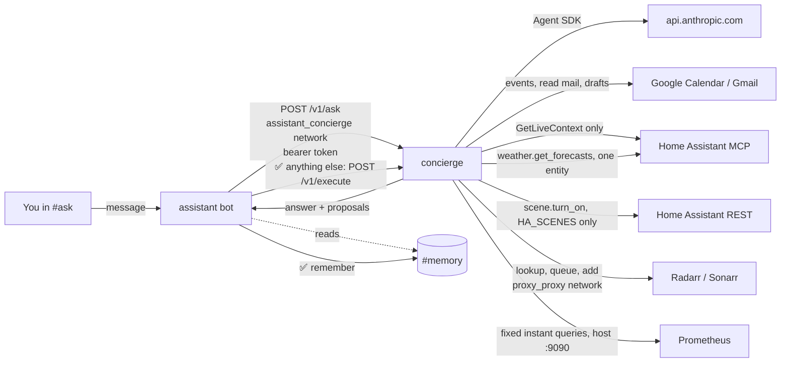

# concierge — the act lane (phase 4: writes behind ✅/❌)

Claude, through the [Claude Agent SDK](https://code.claude.com/docs/en/agent-sdk/python),
answering questions in Discord's **#ask** with read access to your calendar,
mail, home and movie/TV library, and proposing a few changes you approve one tap
at a time: create or move a calendar event, save a Gmail draft, run a Home
Assistant scene, download a movie or show. Design: [`docs/design/tsd-personal-assistant.md`](../../docs/design/tsd-personal-assistant.md).



- **No published port, no Caddy route.** The bot is the only front door; this
  container has no Discord connection. It reaches out to the Claude API, Google,
  Home Assistant and Radarr/Sonarr. It shares `proxy_proxy` with them, so the
  containers there can reach its port; the bearer token keeps them out.
- **Read tools run freely:** `calendar_events`, `mail_search`, `mail_read`,
  `home_overview`, `weather_forecast`, `homelab_status`, `media_search`,
  `media_downloads`.
- **Every write is a proposal.** `remember`, `create_event`, `move_event`,
  `draft_email`, `run_scene`, `add_movie` and `add_show` check their arguments and record a proposal;
  none of them changes anything during the run. The bot renders the stored
  arguments under ✅/❌. A ✅ from an allowlisted user posts a memory to
  #memory, or sends the proposal's id, tool and arguments back to
  `/v1/execute`, which acts only if they match exactly what it stored, once,
  within 16 minutes (`app/actions.py`). No answer within 15 minutes, a bot
  restart or a concierge restart all count as ❌.
- **What it can never do:** send email (drafts only; you send from Gmail),
  delete anything (no movie or show either), invite or notify anyone, or touch
  a lock, alarm or garage door. Those tools do not exist. Scenes are limited to the `HA_SCENES` list.
- **Tiers are enforced in code** (`app/tiers.py`), in a `PreToolUse` hook
  *and* in `can_use_tool`. No Claude Code built-ins (`tools=[]`), nothing
  pre-approved, `permission_mode="default"`, no settings files read.
  `tests/smoke.py` pins all of it.

## What it costs

On-demand only: nothing here is scheduled. Each question is one agent run on
`claude-opus-5-5` ($4 / $20 per MTok), capped at 12 turns and $0.50. Typical
lookups are a few cents; the footer under each answer shows the real figure.
The monthly ceiling is the **`homelab` workspace's spend limit** in the Claude
Console, not anything in this repo.

## Setup

Everything marked **(you)** needs a login that only you have.

### 1. Claude Console (you)

1. Console → Workspaces → create **`homelab`**. Set a monthly spend limit (e.g.
   $20) and an alert (e.g. $10). Keep all workspace limits summed under the
   org's $50 cap (brignano-io has $10).
2. In that workspace, create an API key with a **1-year expiry**. Put a
   renewal reminder on the calendar for a week before it lapses.
3. On CT 100, `cp docker/concierge/.env.example docker/concierge/.env` and put
   the key in `ANTHROPIC_API_KEY`. **The repo is public**, so the key goes in
   that file and nowhere else.

### 2. Shared token

```bash
openssl rand -hex 32
```

Put the same value in `CONCIERGE_TOKEN` in **both** `docker/concierge/.env`
and `docker/assistant/.env`.

### 3. Discord channels

```bash
docker compose -f docker/assistant/docker-compose.yml run --rm --build assistant --provision --apply
```

This creates **#ask** (open) and **#memory** (bot-only) and prints their IDs.
Put them in `docker/assistant/.env` as `DISCORD_ASK_CHANNEL_ID` and
`DISCORD_MEMORY_CHANNEL_ID`. #ask needs the **Message Content** intent, the
same Developer Portal toggle (Bot → Privileged Gateway Intents).

### 4. Google (optional, you)

Reuse the Desktop OAuth client from `docker/assistant/.env`, but sign in
separately. This lane gets `calendar.events`, `gmail.readonly` and
`gmail.compose`; the digest keeps its narrower `gmail.metadata`.

`gmail.compose` is the narrowest Google scope that can create a draft, and
Google lets it send drafts too. So "never sends" is held by code, not by the
scope: `app/google.py` has exactly three write calls (event insert, event
patch, draft create), and a test fails if a send, delete or modify call
appears.

```bash
docker compose -f docker/concierge/docker-compose.yml run --rm --build concierge --google-auth
```

Paste the printed `GOOGLE_REFRESH_TOKEN` into `docker/concierge/.env`.
**Upgrading from phase 3:** run it again. A token from the read-only sign-in
still answers questions, but every approved write fails with a 403 and a hint
to rerun this.

### 5. Home Assistant (optional, you)

1. **Settings → People → Users → Add user** `concierge`, *not* an
   administrator. Log in as it once and create a long-lived token (Profile →
   Security). This must be a different token from the digest's: revoking one
   lane must not break the other.
2. **Settings → Devices & services → Add integration → Model Context Protocol
   Server.** Select the **Assist** API.
3. **Settings → Voice assistants → Expose.** Expose only what the assistant
   should be able to read. **Never expose locks, alarm panels or garage
   covers.** This is the capability ceiling (Decision 3): what is not exposed,
   the agent cannot see or reach, whatever it is told.
4. Put the token in `HA_TOKEN` in `docker/concierge/.env`.
5. Optional, for `run_scene`: list the scenes it may propose in `HA_SCENES`,
   e.g. `scene.movie_night,scene.good_night`. **Read each scene first.** The
   service is fixed to `scene.turn_on` and anything not listed is refused,
   but a scene that itself unlocks a door would unlock it. HA does not apply
   Assist exposure to this REST call, so this list is the ceiling.

The concierge calls only HA's `GetLiveContext` (`app/home.py`) and never any
`Hass*` action. HA's own tool list is never given to the agent.

### 6. Movies and shows (optional, you)

Ask in #ask, *"get Hocus Pocus and The Haunting of Hill House"*, and you get
one ✅/❌ prompt per title:

```
Download this movie? Radarr adds it and searches now.
title: Hocus Pocus
year: 1993
tmdb_id: 10439
quality: HD-1080p
folder: /data/library/movies
```

A ✅ adds it to Radarr (or Sonarr, every season) and starts a search. The
download, the import into Jellyfin's library and the Jellyfin scan are the
downloads stack's usual path (`docker/downloads/README.md`). *"What's
downloading?"* reads both queues: the first 20 entries of each, with the total
so the reply says how many it left out, and Radarr/Sonarr's own reason for a
flagged entry (a message that quotes a path or any file or release name is
dropped).

- The **title and year shown come from Radarr/Sonarr's lookup of the id**, not
  from the model, so the prompt names what the id really is.
- The **quality profile and folder are config**, the same for every add, and
  shown in the prompt. The model cannot pick a different folder or profile.
- A title already in the library is not proposed again.
- Nothing can delete, unmonitor or change a setting: `app/media.py` has two
  writes, both adds, and a test fails if a third appears.

Setup:

1. In **Radarr** and **Sonarr**, *Settings → General → API Key*: copy each into
   `RADARR_API_KEY` and `SONARR_API_KEY` in `docker/concierge/.env`. Either can
   be left blank: no key, no tools for that app.
2. `MEDIA_QUALITY_PROFILE` (default `HD-1080p`) must exist by that exact name in
   both apps (*Settings → Profiles*). The selftest checks it.
3. The folders default to the downloads stack's `/data/library/movies` and
   `/data/library/shows`; override with `RADARR_ROOT` / `SONARR_ROOT` only if
   you changed those root folders.

The concierge reaches them by name over `proxy_proxy`, so the downloads stack
must be up. If it is not, the tools report "could not reach it" and nothing
else is affected.

### 7. Weather forecast and server health (on by default)

- **`weather_forecast`**: the daily (7 days) or hourly (24 hours) forecast
  for **one** weather entity, `HA_WEATHER_ENTITY` (default
  `weather.forecast_home`, the Met.no one). It calls HA's
  `weather.get_forecasts` service over REST, which returns data and changes
  nothing. The path is fixed, and the entity comes from config, never from the
  model. It needs `HA_TOKEN` (step 5). Set `HA_WEATHER_ENTITY=` blank to turn
  it off.
- **`homelab_status`**: *"how's the server doing?"*. Fixed Prometheus instant
  queries: targets up and down, CPU (1h), RAM, root disk, thin pool,
  restarts in 24h, and required containers that are not running. The model
  passes no PromQL. It reaches Prometheus through the port it publishes
  (`host.docker.internal:9090`), so the concierge joins no monitoring network.
  Set `PROMETHEUS_URL=` blank to turn it off.

`--selftest` checks both (`Forecast ok`, `Prometheus ok`).

### 8. Bring it up

The assistant stack owns the `assistant_concierge` network, so it comes up first:

```bash
docker compose -f docker/assistant/docker-compose.yml up -d --build
docker compose -f docker/concierge/docker-compose.yml run --rm --build concierge --selftest
docker compose -f docker/concierge/docker-compose.yml up -d --build
docker compose -f docker/concierge/docker-compose.yml run --rm concierge --ask "what's on my calendar tomorrow?"
```

`--selftest` spends nothing. `--ask` makes one real API call.

Once it is up, `heartbeat.sh` requires the `concierge` container to be running
(`hl-container-missing`). Check RAM with `docker stats` while Ollama is loaded,
and raise `mem_limit` if a real task gets near 1 GB.

## Audit

Every tool call logs one line to stdout, which Alloy ships to Loki:

```logql
{container="concierge"} |= "event=tool_call"
```

`event=task_start`, `event=tool_call` (tool, tier, allow/deny, args),
`event=tool_result` (ok, ms, size), `event=task_end` (turns, cost) and
`event=execute` (proposal id, tool, ok or why not) for every approved write. Bodies
and results are not logged. Approvals, declines, expiries and ignored clicks
log in the **assistant** container (`{container="assistant"} |= "proposal"`).

## Failure modes

| What | What you see |
|---|---|
| Concierge down | #ask replies "Concierge unavailable: the concierge isn't running"; `hl-container-missing` after 10m |
| Token mismatch | "refused: CONCIERGE_TOKEN differs between the two .env files" |
| Google sign-in revoked/expired | the agent reports the tool error, "rerun --google-auth" |
| HA unreachable / token revoked | `home_overview` reports the error; nothing else is affected |
| Forecast fails | "HTTP 4xx … is weather.x the right entity?": `HA_WEATHER_ENTITY` names an entity that does not exist. Check *Settings → Entities* |
| Prometheus unreachable | `homelab_status` reports "could not reach Prometheus"; nothing else is affected. One unreadable query shows in `could_not_read` |
| Radarr/Sonarr down or key wrong | the media tools report "could not reach it" or "API key rejected (401)"; nothing else is affected |
| ✅ but nothing downloads | Radarr/Sonarr added it and searched; no indexer had a release yet. It stays monitored and grabs one when it appears. Check *Wanted* in the app |
| Spend limit reached | the run fails with the API error; the digest is unaffected |
| Busy | a second request waits; past 3 in flight, "busy — try again in a minute" |
| ✅ after the concierge restarted | "failed: expired" under the prompt; nothing runs. Ask again |
| Write with a pre-phase-4 Google token | "failed: HTTP 403 … rerun --google-auth" |

The act lane being down never affects the watch lane: the digest and
the alerts carry on without it.
