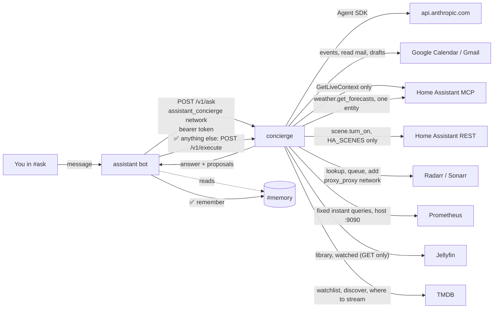

# concierge — the act lane (phase 4: writes behind ✅/❌)

Claude, through the [Claude Agent SDK](https://code.claude.com/docs/en/agent-sdk/python),
answering questions in Discord's **#ask** with read access to your calendar,
mail, home and movie/TV library, and proposing a few changes you approve one tap
at a time: create or move a calendar event, save a Gmail draft, run a Home
Assistant scene, download a movie or show. Design: [`docs/design/tsd-personal-assistant.md`](../../docs/design/tsd-personal-assistant.md).



- **No published port, no Caddy route.** The bot is the only front door; this
  container has no Discord connection. It reaches out to the Claude API, Google,
  Home Assistant and Radarr/Sonarr. It shares `proxy_proxy` with them, so the
  containers there can reach its port; the bearer token keeps them out.
- **Read tools run freely:** `calendar_events`, `mail_search`, `mail_read`,
  `home_overview`, `weather_forecast`, `home_calendar_events`,
  `homelab_status`, `github_status`, `media_search`, `media_downloads`, `movie_night`.
- **Every write is a proposal.** `remember`, `follow_up`, `create_event`, `move_event`,
  `draft_email`, `run_scene`, `add_movie` and `add_show` check their arguments and record a proposal;
  none of them changes anything during the run. The bot renders the stored
  arguments under ✅/❌. A ✅ from an allowlisted user posts a memory to
  #memory or a follow-up to #follow-ups (both in the bot), or sends the proposal's id, tool and arguments back to
  `/v1/execute`, which acts only if they match exactly what it stored, once,
  within 16 minutes (`app/actions.py`). No answer within 15 minutes, a bot
  restart or a concierge restart all count as ❌.
- **What it can never do:** send email (drafts only; you send from Gmail),
  delete anything (no movie or show either), invite or notify anyone, or touch
  a lock, alarm or garage door. Those tools do not exist. Scenes are limited to the `HA_SCENES` list.
- **Tiers are enforced in code** (`app/tiers.py`), in a `PreToolUse` hook
  *and* in `can_use_tool`. No Claude Code built-ins (`tools=[]`), nothing
  pre-approved, `permission_mode="default"`, no settings files read.
  `tests/smoke.py` pins all of it.
- **The morning brief is read-only.** `POST /v1/brief` runs a fixed request
  (`agent.brief_prompt`: mail from the last 24h, 72h on Mondays; calendar
  through the next 7 days) with only the read tools registered and the
  propose tier refused by both gates. The body may carry approved memories
  and nothing else, and its reply never becomes a pending proposal. The bot
  calls it with each scheduled digest when its `BRIEF_ENABLED=true`, under
  its own lower caps (`CONCIERGE_BRIEF_MAX_TURNS` 8,
  `CONCIERGE_BRIEF_MAX_BUDGET_USD` $0.30) and its own cheaper model
  (`CONCIERGE_SCHEDULED_MODEL`, Haiku; #ask keeps `CONCIERGE_MODEL`); see
  [`docker/assistant/README.md`](../assistant/README.md) → "The morning brief".
- **The evening review proposes, but only memories and follow-ups.**
  `POST /v1/review` takes what the bot gathered (today's #ask threads,
  #activity lines, upcoming follow-ups, one line per Home Assistant entity)
  as data, builds a fixed request from it (`agent.review_prompt`), and runs
  with no lookup tools and only `remember` and `follow_up` registered;
  `tiers.decide(..., only=...)` refuses anything else in both gates. Its
  proposals are carried out by the bot and never become pending here. Own
  caps: `CONCIERGE_REVIEW_MAX_TURNS` 6, `CONCIERGE_REVIEW_MAX_BUDGET_USD`
  $0.15, on `CONCIERGE_SCHEDULED_MODEL`. See
  [`docker/assistant/README.md`](../assistant/README.md) → "The evening review".

## What it costs

Nothing here keeps its own schedule. Each question is one agent run on
`claude-opus-5-5` ($4 / $20 per MTok), capped at 12 turns and $0.50, and so
is each follow-up set to **check** when it comes due (a **remind** costs
nothing). The bot's scheduled runs use `claude-haiku-5-5`: the morning brief
(8 turns, $0.30) and the evening review (6 turns, $0.15), each at most once a
day and only when turned on; the review is skipped on a day with nothing in
it. Typical
lookups are a few cents; the footer under each answer shows the real figure.
The monthly ceiling is the **`homelab` workspace's spend limit** in the Claude
Console, not anything in this repo.

## Setup

Everything marked **(you)** needs a login that only you have.

### 1. Claude Console (you)

1. Console → Workspaces → create **`homelab`**. Set a monthly spend limit (e.g.
   $20) and an alert (e.g. $10). Keep all workspace limits summed under the
   org's $50 cap (brignano-io has $10).
2. In that workspace, create an API key with a **1-year expiry**. Put a
   renewal reminder on the calendar for a week before it lapses.
3. On CT 100, `cp docker/concierge/.env.example docker/concierge/.env` and put
   the key in `ANTHROPIC_API_KEY`. **The repo is public**, so the key goes in
   that file and nowhere else.

### 2. Shared token

```bash
openssl rand -hex 32
```

Put the same value in `CONCIERGE_TOKEN` in **both** `docker/concierge/.env`
and `docker/assistant/.env`.

### 3. Discord channels

```bash
docker compose -f docker/assistant/docker-compose.yml run --rm --build assistant --provision --apply
```

This creates **#ask** (open) and **#memory** (bot-only) and prints their IDs.
Put them in `docker/assistant/.env` as `DISCORD_ASK_CHANNEL_ID` and
`DISCORD_MEMORY_CHANNEL_ID`. #ask needs the **Message Content** intent, the
same Developer Portal toggle (Bot → Privileged Gateway Intents).
It also creates **#activity** and **#follow-ups** (both bot-only); put their
IDs in `DISCORD_ACTIVITY_CHANNEL_ID` and `DISCORD_FOLLOWUPS_CHANNEL_ID` to log
approved actions and to keep approved follow-ups. `REVIEW_ENABLED=true` (and
optionally `REVIEW_HA_ENTITIES`) in the same file turns on the evening review.

### 4. Google (optional, you)

Reuse the Desktop OAuth client from `docker/assistant/.env`, but sign in
separately. This lane gets `calendar.events`, `gmail.readonly` and
`gmail.compose`; the digest keeps its narrower `gmail.metadata`.

`gmail.compose` is the narrowest Google scope that can create a draft, and
Google lets it send drafts too. So "never sends" is held by code, not by the
scope: `app/google.py` has exactly three write calls (event insert, event
patch, draft create), and a test fails if a send, delete or modify call
appears.

```bash
docker compose -f docker/concierge/docker-compose.yml run --rm --build concierge --google-auth
```

Paste the printed `GOOGLE_REFRESH_TOKEN` into `docker/concierge/.env`.
**Upgrading from phase 3:** run it again. A token from the read-only sign-in
still answers questions, but every approved write fails with a 403 and a hint
to rerun this.

### 5. Home Assistant (optional, you)

1. **Settings → People → Users → Add user** `concierge`, *not* an
   administrator. Log in as it once and create a long-lived token (Profile →
   Security). This must be a different token from the digest's: revoking one
   lane must not break the other.
2. **Settings → Devices & services → Add integration → Model Context Protocol
   Server.** Select the **Assist** API.
3. **Settings → Voice assistants → Expose.** Expose only what the assistant
   should be able to read. **Never expose locks, alarm panels or garage
   covers.** This is the capability ceiling (Decision 3): what is not exposed,
   the agent cannot see or reach, whatever it is told.
4. Put the token in `HA_TOKEN` in `docker/concierge/.env`.
5. Optional, for `run_scene`: list the scenes it may propose in `HA_SCENES`,
   e.g. `scene.movie_night,scene.good_night`. **Read each scene first.** The
   service is fixed to `scene.turn_on` and anything not listed is refused,
   but a scene that itself unlocks a door would unlock it. HA does not apply
   Assist exposure to this REST call, so this list is the ceiling.

The concierge calls only HA's `GetLiveContext` (`app/home.py`) and never any
`Hass*` action. HA's own tool list is never given to the agent.

### 6. Movies and shows (optional, you)

Ask in #ask, *"get Hocus Pocus and The Haunting of Hill House"*, and you get
one ✅/❌ prompt per title:

```
Download this movie? Radarr adds it and searches now.
title: Hocus Pocus
year: 1993
tmdb_id: 10439
quality: HD-1080p
folder: /data/library/movies
```

A ✅ adds it to Radarr (or Sonarr, every season) and starts a search. The
download, the import into Jellyfin's library and the Jellyfin scan are the
downloads stack's usual path (`docker/downloads/README.md`). *"What's
downloading?"* reads both queues: the first 20 entries of each, with the total
so the reply says how many it left out, and Radarr/Sonarr's own reason for a
flagged entry (a message that quotes a path or any file or release name is
dropped).

- The **title and year shown come from Radarr/Sonarr's lookup of the id**, not
  from the model, so the prompt names what the id really is.
- The **quality profile and folder are config**, the same for every add, and
  shown in the prompt. The model cannot pick a different folder or profile.
- A title already in the library is not proposed again.
- Nothing can delete, unmonitor or change a setting: `app/media.py` has two
  writes, both adds, and a test fails if a third appears.

Setup:

1. In **Radarr** and **Sonarr**, *Settings → General → API Key*: copy each into
   `RADARR_API_KEY` and `SONARR_API_KEY` in `docker/concierge/.env`. Either can
   be left blank: no key, no tools for that app.
2. `MEDIA_QUALITY_PROFILE` (default `HD-1080p`) must exist by that exact name in
   both apps (*Settings → Profiles*). The selftest checks it.
3. The folders default to the downloads stack's `/data/library/movies` and
   `/data/library/shows`; override with `RADARR_ROOT` / `SONARR_ROOT` only if
   you changed those root folders.

The concierge reaches them by name over `proxy_proxy`, so the downloads stack
must be up. If it is not, the tools report "could not reach it" and nothing
else is affected.

### 7. Weather forecast and server health (on by default)

- **`weather_forecast`**: the daily (7 days) or hourly (24 hours) forecast
  for **one** weather entity, `HA_WEATHER_ENTITY` (default
  `weather.forecast_home`, the Met.no one). It calls HA's
  `weather.get_forecasts` service over REST, which returns data and changes
  nothing. The path is fixed, and the entity comes from config, never from the
  model. It needs `HA_TOKEN` (step 5). Set `HA_WEATHER_ENTITY=` blank to turn
  it off.
- **`home_calendar_events`** (off until `HA_CALENDARS` is set): events on
  the calendars Home Assistant can see, from today through up to 14 days. This
  is how the agent sees the Apple calendar (HA's CalDAV integration), privately,
  with no public iCloud link. `GET /api/calendars/<entity>` only, for the
  `calendar.*` IDs in `HA_CALENDARS`, checked at startup; the model picks only
  how many days ahead. Use the same IDs as `docker/assistant/.env`. If the
  concierge's HA user can't read one, the tool reports it.
- **`homelab_status`**: *"how's the server doing?"*. Fixed Prometheus instant
  queries: targets up and down, CPU (1h), RAM, root disk, thin pool,
  restarts in 24h, and required containers that are not running. The model
  passes no PromQL. It reaches Prometheus through the port it publishes
  (`host.docker.internal:9090`), so the concierge joins no monitoring network.
  Set `PROMETHEUS_URL=` blank to turn it off.
- **`github_status`** (off until `GITHUB_TOKEN` is set): *"anything broken on
  brignano.io?"*. For each repository in `GITHUB_REPOS` (`*` = every
  repository the token can see, minus forks and archived ones, re-listed
  hourly; repositories with nothing open collapse into one `quiet` list):
  open PRs (author,
  age, draft, bot or not), workflows whose latest run on the default branch
  failed, and open Dependabot alerts by severity. GET only, fixed paths on
  `api.github.com`; the model can name one of the configured repositories and
  nothing else. The token is a **fine-grained** personal access token
  (github.com → Settings → Developer settings → Fine-grained tokens): All
  repositories with `GITHUB_REPOS=*`, or only the listed ones, and Metadata, Pull requests, Actions and Dependabot
  alerts, all **Read-only**, with a 1-year expiry. Not a GitHub App: one
  person, read-only, so short-lived installation tokens buy little for a
  private key on the box and a JWT exchange to maintain. An expired token is
  a 401, and the tool says so in one sentence instead of reporting "nothing
  open". A permission it lacks (alerts turned off, a repository left out of
  the token) shows in `could_not_read`, never as zero. The morning brief
  calls it too and gives a bullet only for a red default-branch workflow or a
  critical/high Dependabot alert, or for an expired token.

`--selftest` checks all three (`Forecast ok`, `Prometheus ok`, `GitHub ok`).

### 8. Movie night (optional, you)

Ask in #ask, *"movie night, she likes comedies and thrillers, nothing over 2
hours"*, and you get three picks, one line each, with where to watch them:

```
Game Night (2018) · 7.0 · 1h40 · in Jellyfin, ready to play
Palm Springs (2020) · 7.3 · 1h30 · on Hulu (yours)
The Nice Guys (2016) · 7.4 · 1h56 · rent on Apple TV or Prime Video
```

(Illustrative; the real picks come from your library and TMDB.)

*"Something else"* gives three more, without the ones you've already seen
offered. `movie_night` is a read tool: it picks, it never adds, downloads or
changes anything. Its backlog is three things merged into one ranked pool:

1. **Your Jellyfin library**, minus what `JELLYFIN_USER` has already watched.
   Library titles rank higher: nothing to sign in to.
2. **Your watchlist**: a list on themoviedb.org. Whenever someone mentions
   something good, add it from TMDB's site on your phone. Watchlist titles
   rank higher too.
3. **Well-rated titles in those genres** (TMDB rating 6.8+, enough votes to
   mean it), streaming on your services when `STREAMING_SERVICES` is set, so
   there are always picks even with an empty watchlist.

Anything already watched in Jellyfin is left out wherever it came from.
Runtime is checked against TMDB for each pick, so "under 2 hours" holds. For a
show, the limit is per episode. Streaming data is JustWatch's, through TMDB,
for `WATCH_REGION`.

Setup, all in `docker/concierge/.env`; either half works without the other:

1. **TMDB** (free): make an account on [themoviedb.org](https://www.themoviedb.org),
   then *Settings → API → Create → Developer*. Copy the **API Read Access
   Token** (the long one) into `TMDB_TOKEN`.
2. **Watchlist**: on TMDB, *your profile → Lists → Create list* (e.g. "Movie
   night"), set it **public** (the token can read only public lists), and
   paste its address into `TMDB_LIST_ID`.
3. **Your services**: `STREAMING_SERVICES=Netflix,Hulu,Max,Disney Plus,Amazon Prime Video`,
   or whichever you pay for. `--selftest` names any TMDB doesn't know.
4. **Jellyfin**: *Dashboard → API Keys → +*, into `JELLYFIN_API_KEY`. (Jellyfin
   keys are admin-scoped; this code only ever GETs, and a test pins that.) Set
   `JELLYFIN_USER` to your Jellyfin username (whose "watched" counts), and
   `JELLYFIN_PUBLIC_URL` to the address you open Jellyfin at for a
   tap-to-play link under each library pick. It reaches Jellyfin at
   `http://jellyfin:8096` over `proxy_proxy`.

`--selftest` prints `TMDB ok (… services matched, watchlist N titles)` and
`Jellyfin ok (N movies, N shows, N not watched yet)`. Replies are cached for 10
minutes, so asking again is quick and costs TMDB nothing.

### 9. Bring it up

The assistant stack owns the `assistant_concierge` network, so it comes up first:

```bash
docker compose -f docker/assistant/docker-compose.yml up -d --build
docker compose -f docker/concierge/docker-compose.yml run --rm --build concierge --selftest
docker compose -f docker/concierge/docker-compose.yml up -d --build
docker compose -f docker/concierge/docker-compose.yml run --rm concierge --ask "what's on my calendar tomorrow?"
```

`--selftest` spends nothing. `--ask` makes one real API call.

Once it is up, `heartbeat.sh` requires the `concierge` container to be running
(`hl-container-missing`). Check RAM with `docker stats` while Ollama is loaded,
and raise `mem_limit` if a real task gets near 1 GB.

## Audit

Every tool call logs one line to stdout, which Alloy ships to Loki:

```logql
{container="concierge"} |= "event=tool_call"
```

`event=task_start`, `event=tool_call` (tool, tier, allow/deny, args),
`event=tool_result` (ok, ms, size), `event=task_end` (turns, cost) and
`event=execute` (proposal id, tool, ok or why not) for every approved write. Bodies
and results are not logged. Approvals, declines, expiries and ignored clicks
log in the **assistant** container (`{container="assistant"} |= "proposal"`).

## Failure modes

| What | What you see |
|---|---|
| Concierge down | #ask replies "Concierge unavailable: the concierge isn't running"; `hl-container-missing` after 10m |
| Token mismatch | "refused: CONCIERGE_TOKEN differs between the two .env files" |
| Google sign-in revoked/expired | the agent reports the tool error, "rerun --google-auth" |
| HA unreachable / token revoked | `home_overview` reports the error; nothing else is affected |
| Forecast fails | "HTTP 4xx … is weather.x the right entity?": `HA_WEATHER_ENTITY` names an entity that does not exist. Check *Settings → Entities* |
| Home calendar fails | "HTTP 4xx … is calendar.x the right entity?": an ID in `HA_CALENDARS` that HA does not know |
| Prometheus unreachable | `homelab_status` reports "could not reach Prometheus"; nothing else is affected. One unreadable query shows in `could_not_read` |
| GitHub token expired or revoked | `github_status` says "GitHub refused the token (401)" and how to make a new one; nothing else is affected |
| GitHub token missing a permission or repository | that repository's `could_not_read` names it (e.g. `alerts (HTTP 403)`); `--selftest` fails on it |
| TMDB or Jellyfin down, key wrong | `movie_night` still answers from the other one and says which it couldn't read |
| A service in `STREAMING_SERVICES` not matched | `--selftest` names it; use the name JustWatch shows |
| Radarr/Sonarr down or key wrong | the media tools report "could not reach it" or "API key rejected (401)"; nothing else is affected |
| ✅ but nothing downloads | Radarr/Sonarr added it and searched; no indexer had a release yet. It stays monitored and grabs one when it appears. Check *Wanted* in the app |
| Spend limit reached | the run fails with the API error; the digest is unaffected |
| Busy | a second request waits; past 3 in flight, "busy — try again in a minute" |
| ✅ after the concierge restarted | "failed: expired" under the prompt; nothing runs. Ask again |
| Write with a pre-phase-4 Google token | "failed: HTTP 403 … rerun --google-auth" |

The act lane being down never affects the watch lane: the digest and
the alerts carry on without it.
