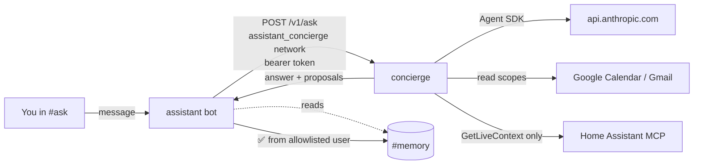

# concierge — the act lane (phase 3: read tools only)

Claude, through the [Claude Agent SDK](https://code.claude.com/docs/en/agent-sdk/python),
answering questions in Discord's **#ask** with read access to your calendar,
mail and home. Design: [`docs/design/tsd-personal-assistant.md`](../../docs/design/tsd-personal-assistant.md).



- **No published port, no Caddy route.** The bot is the only front door; this
  container has no Discord connection. It reaches out to the Claude API, Google
  and Home Assistant, and nothing reaches in except the bot.
- **Read tools only.** `calendar_events`, `mail_search`, `mail_read`,
  `home_overview`. Nothing that writes is registered.
- **`remember` is the one write**, and it does not happen here. The tool only
  records a proposal. The bot renders the exact text under ✅/❌, and only a ✅
  from an allowlisted user posts it to #memory. If nobody answers within 15
  minutes, or the bot restarts first, it counts as ❌.
- **Tiers are enforced in code** (`app/tiers.py`), in a `PreToolUse` hook
  *and* in `can_use_tool`. No Claude Code built-ins (`tools=[]`), nothing
  pre-approved, `permission_mode="default"`, no settings files read.
  `tests/smoke.py` pins all of it.

## What it costs

On-demand only: nothing here is scheduled. Each question is one agent run on
`claude-opus-5-5` ($4 / $20 per MTok), capped at 12 turns and $0.50. Typical
lookups are a few cents; the footer under each answer shows the real figure.
The monthly ceiling is the **`homelab` workspace's spend limit** in the Claude
Console, not anything in this repo.

## Setup

Everything marked **(you)** needs a login that only you have.

### 1. Claude Console (you)

1. Console → Workspaces → create **`homelab`**. Set a monthly spend limit (e.g.
   $20) and an alert (e.g. $10). Keep all workspace limits summed under the
   org's $50 cap (brignano-io has $10).
2. In that workspace, create an API key with a **1-year expiry**. Put a
   renewal reminder on the calendar for a week before it lapses.
3. On CT 100, `cp docker/concierge/.env.example docker/concierge/.env` and put
   the key in `ANTHROPIC_API_KEY`. **The repo is public**, so the key goes in
   that file and nowhere else.

### 2. Shared token

```bash
openssl rand -hex 32
```

Put the same value in `CONCIERGE_TOKEN` in **both** `docker/concierge/.env`
and `docker/assistant/.env`.

### 3. Discord channels

```bash
docker compose -f docker/assistant/docker-compose.yml run --rm --build assistant --provision --apply
```

This creates **#ask** (open) and **#memory** (bot-only) and prints their IDs.
Put them in `docker/assistant/.env` as `DISCORD_ASK_CHANNEL_ID` and
`DISCORD_MEMORY_CHANNEL_ID`. #ask needs the **Message Content** intent, the
same toggle #chat uses.

### 4. Google (optional, you)

Reuse the Desktop OAuth client from `docker/assistant/.env`, but sign in
separately. This lane gets `gmail.readonly` and `calendar.events.readonly`;
the digest keeps its narrower `gmail.metadata`.

```bash
docker compose -f docker/concierge/docker-compose.yml run --rm --build concierge --google-auth
```

Paste the printed `GOOGLE_REFRESH_TOKEN` into `docker/concierge/.env`. Phase 4
reruns this with the write scopes.

### 5. Home Assistant (optional, you)

1. **Settings → People → Users → Add user** `concierge`, *not* an
   administrator. Log in as it once and create a long-lived token (Profile →
   Security). This must be a different token from the digest's: revoking one
   lane must not break the other.
2. **Settings → Devices & services → Add integration → Model Context Protocol
   Server.** Select the **Assist** API.
3. **Settings → Voice assistants → Expose.** Expose only what the assistant
   should be able to read. **Never expose locks, alarm panels or garage
   covers.** This is the capability ceiling (Decision 3): what is not exposed,
   the agent cannot see or reach, whatever it is told.
4. Put the token in `HA_TOKEN` in `docker/concierge/.env`.

The concierge calls only HA's `GetLiveContext` (`app/home.py`) and never any
`Hass*` action. HA's own tool list is never given to the agent.

### 6. Bring it up

The assistant stack owns the `assistant_concierge` network, so it comes up first:

```bash
docker compose -f docker/assistant/docker-compose.yml up -d --build
docker compose -f docker/concierge/docker-compose.yml run --rm --build concierge --selftest
docker compose -f docker/concierge/docker-compose.yml up -d --build
docker compose -f docker/concierge/docker-compose.yml run --rm concierge --ask "what's on my calendar tomorrow?"
```

`--selftest` spends nothing. `--ask` makes one real API call.

Once it is up, `heartbeat.sh` requires the `concierge` container to be running
(`hl-container-missing`). Check RAM with `docker stats` while Ollama is loaded,
and raise `mem_limit` if a real task gets near 1 GB.

## Audit

Every tool call logs one line to stdout, which Alloy ships to Loki:

```logql
{container="concierge"} |= "event=tool_call"
```

`event=task_start`, `event=tool_call` (tool, tier, allow/deny, args),
`event=tool_result` (ok, ms, size) and `event=task_end` (turns, cost). Bodies
and results are not logged. Approvals, declines, expiries and ignored clicks
log in the **assistant** container (`{container="assistant"} |= "proposal"`).

## Failure modes

| What | What you see |
|---|---|
| Concierge down | #ask replies "Concierge unavailable: the concierge isn't running"; `hl-container-missing` after 10m |
| Token mismatch | "refused: CONCIERGE_TOKEN differs between the two .env files" |
| Google sign-in revoked/expired | the agent reports the tool error, "rerun --google-auth" |
| HA unreachable / token revoked | `home_overview` reports the error; nothing else is affected |
| Spend limit reached | the run fails with the API error; the digest and #chat are unaffected |
| Busy | a second request waits; past 3 in flight, "busy — try again in a minute" |

The act lane being down never affects the watch lane: the digest, #chat and
the alerts carry on without it.
