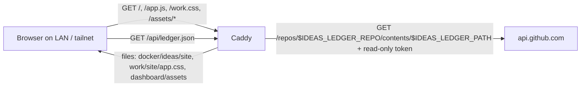

# ideas — the idea ledger beside Work

`https://ideas.$HOMELAB_DOMAIN`: every idea in the ledger on one page, grouped
by stage (Building, Proposals, Inbox, with the archive folded away), with the
ones ready to move counted first. It sits beside the Work page: a Work / Ideas
switch at the top of each, one stylesheet, and a tile for each on the home
page. It reads the ledger live on every load (and on Refresh); the browser
keeps its last load and draws it at once on the next visit.



**There is no container.** Caddy serves `site/` and answers one route by
reading one file from GitHub with a token it holds. The browser never sees
the token, the repo or the path, and cannot choose what is read: the path is
fixed in `.env`. The route is GET only, refuses a browser `Origin` other than
`https://ideas.<domain>` with a 403, and strips GitHub's `Access-Control-*`
headers, so another site open in a browser on the LAN cannot read it.

The token is **shared with Work**: `READ_GITHUB_TOKEN` in `docker/proxy/.env`,
read-only, covering the fleet repos and the ledger's repo. Work's route runs
any GraphQL query, so on the LAN and tailnet it can read the ledger's repo too;
that was Anthony's call (one token to manage). The compose file still accepts
the per-page names (`WORK_GITHUB_TOKEN`, `IDEAS_GITHUB_TOKEN`) if you ever
want them split again: set those and leave `READ_GITHUB_TOKEN` unset.

## ledger.json

The ledger's build writes this file into its repo. An array of ideas, or
`{ "ideas": [...] }`, each:

| Field | Meaning |
|---|---|
| `title`, `summary` | What it is |
| `stage` | `inbox`, `proposals`, `accepted` (shown with proposals), `building` or `archive` |
| `cls` | Kind: Income, Quality of life, People, Public good, Craft or Unclassified. A leading emoji is dropped |
| `ev` | Proof grade `E0`-`E4` (or `""`). The page shows words, never the code: Just an idea, Researched, Someone wants it, Someone committed, Proven |
| `tone` | Verdict pill: `good` Go, `side` Look, `bet` Bet, `park` Parked, `none` Unscored |
| `verdict` | The one-line verdict under the title |
| `repo` (optional) | The fleet repo it is being built in. The idea shows under Building, with a "Building in <repo> →" link to Work filtered to that repo |
| `url` (optional) | Its page on github.com, for "Open in GitHub" |

The page stays in step with the file: no field is read from anywhere else.

## Setup (once)

1. Reuse Work's: add the ledger's repo to `READ_GITHUB_TOKEN`
   (docker/work/README.md, Setup). It needs **Contents: Read-only**.
2. On CT 100, `docker/proxy/.env` needs:
   ```sh
   READ_GITHUB_TOKEN=github_pat_...
   IDEAS_LEDGER_REPO=<owner>/<repo>
   IDEAS_LEDGER_PATH=ledger.json
   ```
3. Recreate Caddy so it reads the new variables and mount:
   ```sh
   hl-ssh -t "cd /root/homelab && claude '/deploy proxy'"
   ```

Until all three are set, or until the ledger's build writes `ledger.json`, the
page says which one is missing instead of showing nothing.

## Tests

```sh
node docker/ideas/tests/screenshots.mjs [outdir]
```

Demo ledger, stubbed route, no network: checks the counts, sections, the kind
menu (no native `<select>`), the proof filter, the error states and the cached
copy, and writes phone and desktop screenshots in light and dark.
