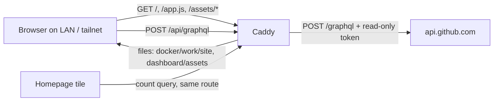

# work — open issues and PRs across the fleet repos

`https://work.$HOMELAB_DOMAIN`: one page that shows what is waiting on you, what
agents are building, what is up next and what is blocked, across every repo in
ai-tools `fleet/board.yml`. It reads GitHub live on every load (and on
Refresh), so nothing runs on a schedule and nothing is cached. It replaces the
GitHub Projects board, which needed the `fleet-board` Action and its Actions
minutes to stay in sync (#384, ai-tools#109). Issue: #386.



**There is no container.** Caddy serves `site/` and adds the token to one
route. The browser never sees the token, and the token is read-only, which is
what makes the route read-only: GitHub refuses a mutation from it.

## What it shows

Status follows the fleet standard's table ("Status, priority and blocked" in
brignano/ai-tools `fleet/README.md`), computed from labels in `site/app.js`:

| Labels | Section | Pill |
|---|---|---|
| `needs:anthony` | Waiting on you | Needs you, or Ready to merge for a PR with green checks |
| `agent:working` + an open PR that closes it | In progress | In review, or Checks failing |
| `agent:working`, no PR | In progress | Building, or Stalled after 24h with no activity |
| open PR, not held | In progress | In review / Draft / Checks failing |
| `blocked` / `agent:pause` / `lead` | Blocked or held | Blocked (with its `Blocked by` line) / Paused / Lead |
| no `## Decisions` (filed since 2026-11-02), a `Release plan:`, a bot or outsider | Blocked or held | Proposed |
| anything else | Up next | Start button |

Tap a row for its Problem, Acceptance criteria and last comment. Group by
status or repo, sort six ways, filter by repo or by tapping a count. Rows idle
for 30+ days say so (the same 30 days as Fleet backlog health). Closed and
merged items drop off on the next load and show under "Done this week".

**Start** copies `build <repo>#N` for pasting into that repo's Claude project.
`site/config.json` maps repo names to project URLs for the toast's "Open
project" link; a repo without an entry links to claude.ai/code. A real one-tap
start is #387.

life, people and ideas are never shown: the page drops anything outside
`board.yml` `repos:` (and anything under `never:`), and the token should not
be granted those repos at all.

## Setup (once)

1. Create a **fine-grained** token at
   https://github.com/settings/personal-access-tokens/new:
   - Repository access: **Only select repositories**, the repos in
     `board.yml` `repos:` (ai-tools included). Never life, people or ideas.
   - Permissions, all **Read-only**: Contents, Issues, Pull requests, Commit
     statuses. Metadata is added automatically.
2. On CT 100, add it to `docker/proxy/.env`:
   ```sh
   WORK_GITHUB_TOKEN=github_pat_...
   ```
3. Recreate Caddy so it reads the new variable and mount:
   ```sh
   hl-ssh -t "cd /root/homelab && claude '/deploy proxy'"
   ```
   Then restart the dashboard so Homepage serves the new `work.svg` tile icon
   (it lists `/app/public` once at startup):
   ```sh
   hl-ssh -t "cd /root/homelab && claude '/deploy dashboard'"
   ```

When a repo joins the fleet, add it to the token too (GitHub settings, the same
token, Repository access). `board.yml` alone is not enough: the page lists the
repo, but GitHub returns nothing from a repo the token cannot see.

## Changing the page

`site/` is plain HTML, CSS and JS with no build step. Caddy mounts it
read-only, so a merged change is live on the next `git pull`; no restart.
Styles come only from the design system tokens (`/assets/design-tokens.css`,
the dashboard's vendored copy). Never type a colour.

To try it without a token, serve `site/` with any static server and stub
`/api/graphql`; `tests/screenshots.mjs` does exactly that with demo data and
writes phone and desktop screenshots.

## If it breaks

| What you see | Why | Fix |
|---|---|---|
| "GitHub refused the token (401)" | `WORK_GITHUB_TOKEN` unset, expired or revoked | New token, update `.env`, `/deploy proxy` |
| "Could not read fleet/board.yml" | Token lacks Contents: read on ai-tools | Add ai-tools to the token |
| A repo is listed but always empty | Token was not granted that repo | Add it to the token |
| No "checks passing" words | Token lacks Commit statuses: read | Add the permission |
| Dashboard tile shows no numbers | Same token problem, or Homepage not restarted | Fix the token; `/deploy dashboard` |
