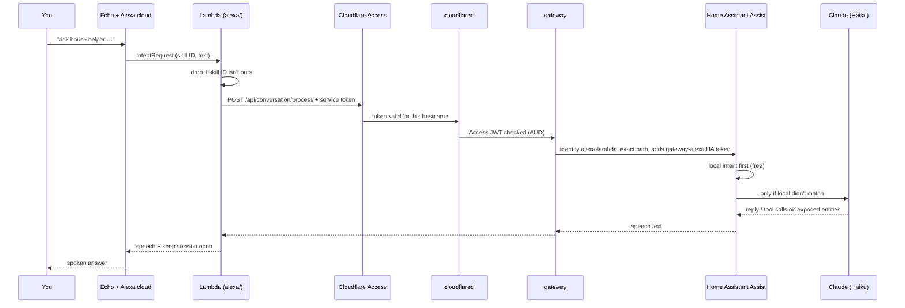

# TSD: Ask Home Assistant's Claude-powered Assist through Alexa

**Status:** accepted 2026-11-09 — tracked in #363, decision record [`decisions/0003-alexa-assist.md`](../../decisions/0003-alexa-assist.md), builds after the secure gateway (#362)
**Date:** 2026-11-09
**Owner:** Anthony

## Problem

Alexa already controls the house through Matterbridge
([`docker/matterbridge/`](../../docker/matterbridge/README.md)): the Echos see
every Home Assistant entity labelled **Alexa** as a Matter device, over the
LAN. That works well for "turn off the kitchen lights", but it's all Alexa can
do with the house. It can't:

- answer questions about the house ("is anything left on?", "is the car
  charging?", "what's the temperature inside?");
- do several things at once ("turn everything off downstairs and set the heat
  to 66");
- keep a short conversation going ("…and the bedroom?").

Home Assistant's own voice assistant (Assist) can do all of that when it uses
Claude as its conversation agent. The Echos can't talk to Assist on their own,
and swapping their firmware ([hermes-voice / echo-dot-assist](https://github.com/majorminorlabs/hermes-voice))
would mean jailbreaking them and losing Alexa. That was looked at and rejected
on 2026-11-09.

The way to do it on the Echos you already have is a **private Alexa skill**.
Its code runs in AWS Lambda, so it needs one endpoint on CT 100 that is
reachable from the internet. The [secure gateway](tsd-secure-gateway.md) was
designed for exactly this, and Alexa is its first endpoint.

## What you'll see

- "Alexa, ask **house helper** whether anything's left on." Alexa answers in
  her own voice with Assist's reply. 
- "Alexa, ask house helper to turn off everything downstairs and set the heat
  to 66." It's done, and Alexa says what changed.
- Alexa keeps listening for a few seconds after a reply, so you can follow up
  ("and the bedroom?") without saying the name again. Silence or "stop" ends
  the session.
- Simple commands still go through Matterbridge, with no change: "Alexa, turn
  off the kitchen lights" stays local, free and instant.
- Anything Assist isn't allowed to touch (locks, the alarm, the garage) gets
  a spoken "I can't do that".

## Approach

### 1. The Alexa skill

- A **custom skill in development stage**, created in the Alexa developer
  console on your Amazon account. A development skill works on every Echo
  registered to that account and on no one else's. It's never submitted for
  certification or published, so Amazon never reviews it and nobody else can
  enable it. This is Amazon's documented way of building a skill for
  yourself, so it's within their terms.
- Interaction model: one intent, `AskIntent`, whose only slot is an
  `AMAZON.SearchQuery` catching everything after a carrier phrase
  ("ask house helper **to** …", "**whether** …", "**what** …", "**is** …").
  It also has `AMAZON.FallbackIntent`, `AMAZON.StopIntent`,
  `AMAZON.CancelIntent` and `AMAZON.HelpIntent`. The model is checked into
  `alexa/skill/interaction-model.json`, so it's reviewed like code.
- The endpoint is the Lambda's ARN, with the **skill ID trigger** set. Only
  that skill can invoke the function.

### 2. The Lambda (`alexa/lambda/`)

- Python 3.13, **stdlib only** (`urllib`, `json`). No dependencies to patch,
  and the deploy is a single zip of about 5 KB.
- It runs in `us-east-1`, the region Alexa's North America endpoint calls.
  128 MB, timeout 7 s.
- What it does, in order:
  1. Rejects any request whose `applicationId` isn't the skill ID in its
     environment. It never calls the gateway in that case.
  2. Takes the `SearchQuery` text. On `LaunchRequest` ("Alexa, open house
     helper") it says "What do you need?" and waits.
  3. Calls `POST https://$GW_HOST/api/conversation/process` with
     `{"text", "language": "en", "conversation_id"}`, the
     `CF-Access-Client-Id` / `CF-Access-Client-Secret` headers, and a 6.5 s
     timeout.
  4. Speaks `response.speech.plain.speech`, keeps the session open
     (`shouldEndSession: false`, with a reprompt), and saves
     `conversation_id` in the session attributes so follow-ups keep their
     context.
  5. On a timeout or any error, says one short line ("The house didn't
     answer in time, try again") and ends the session. The error is logged
     to CloudWatch without the spoken text.
- Its environment has the skill ID, the hostname and the service token
  (encrypted at rest with the default Lambda KMS key). It has **no Home
  Assistant token**, as the gateway TSD requires.
- Logs keep 14 days in CloudWatch (set on the log group). They hold request
  IDs, intents, status codes and timings, never what you said.

### 3. The gateway route

This is one route block in `docker/gateway/`, following the gateway's
per-endpoint checklist (`docs/runbook-gateway.md`). Nothing here is new
design:

| | |
|---|---|
| Hostname | new random first-level label, in `docker/gateway/.env` only |
| Access app | its own, a Service Auth policy for the one token `alexa-lambda`, 401 response, 1-year token with the expiry alert on |
| Allowed | `POST /api/conversation/process`, body ≤ 8 KB. Everything else is `404` |
| Identity | `alexa-lambda` only |
| Upstream | `host.docker.internal:8123`, with the `gateway-alexa` HA token added by the gateway |
| Expected source | AWS (the access-log poller alerts if the token is used from anywhere else) |

### 4. Home Assistant

- **A new non-admin user `gateway-alexa`** ("Can only log in from the local
  network" on: the gateway reaches HA from CT 100 itself). Its long-lived
  token lives only in `docker/gateway/.env`. Actions show up in the logbook
  under that name.
- **The Anthropic integration** (built into HA) with its own Anthropic API
  key named `home-assistant`, so its spend shows separately in the Console
  and can have its own monthly limit. Model: Claude Haiku. "Control Home
  Assistant" set to **Assist**, and **"Prefer handling commands locally"
  on**: HA's built-in intents answer simple commands for free and in under a
  second, and only the rest go to Claude.
- The Lambda passes the Claude conversation agent's `agent_id` (from its
  environment), so the Alexa path doesn't change when the preferred pipeline
  in the HA app changes. Swapping the model later is a setting in HA's
  Anthropic integration, with no redeploy.
- **What Assist can reach:** Assist uses HA's global **Expose** list
  (Settings → Voice assistants → Expose), which is separate from the
  Matterbridge **Alexa** label. Decision 2 sets it to the entities that carry
  the Alexa label. Locks, the alarm, the garage cover, the car's controls and the litter
  box are never exposed. CI can't check that, because exposure lives in HA's
  `.storage`. The build PR lists the exposed entities, and the runbook has a
  monthly check.

### 5. Deploying the Lambda

Decision 4: a GitHub Action
(`.github/workflows/alexa-lambda.yml`) on pushes to `main` that touch
`alexa/lambda/`. It zips the code and calls `UpdateFunctionCode`. It signs in
to AWS with **GitHub OIDC**, so no long-lived AWS key is stored anywhere, and
uses a role whose only permission is `lambda:UpdateFunctionCode` on this one
function. Creating the function, its role and its environment variables is a
one-time step, done from your Mac with a script in `alexa/` (or by Claude
through the AWS connector with your OK).

## Decisions (accepted by Anthony, 2026-11-09)

1. **The brain is HA Assist with Claude Haiku**, not Otto and not local
   intents only. Rejected: Otto (its writes need a ✅ in Discord, which voice
   can't give, and it would make Otto public); local intents only (no smarter
   than Matterbridge).
2. **Assist may control the same entities that carry the Alexa label**, kept
   in step with Matterbridge's list. Locks, the alarm, the garage, the car's
   controls and the litter box are never exposed.
3. **Invocation name: "house helper".**
4. **The Lambda deploys from a GitHub Action** that signs in to AWS with
   OIDC, using a role whose only permission is `lambda:UpdateFunctionCode`
   on this function. No AWS key is stored. Creating the function the first
   time is the one-time `alexa/setup.sh`.

## Threat model (only what's new beyond the gateway TSD)

| Risk | Mitigation |
|---|---|
| Someone else's skill or a forged request invokes the Lambda | Skill ID trigger on the function, plus a skill ID check in code |
| The Lambda's service token leaks (from AWS) | It works only on this hostname and path, and reaches HA only as `gateway-alexa`. The poller alerts on use outside AWS. Rotate in the Cloudflare dashboard |
| Your AWS account is compromised | Same blast radius as a leaked token. Root on a hardware key or passkey, and the deploy role can only update the code of this one function |
| Prompt injection (a device or calendar name telling Claude to do something) | Claude can only call Assist's intents on exposed entities, and the never-list is never exposed |
| Someone in the room (or a TV) speaks to the Echo | Same as Alexa today: it can do what Assist can do, and nothing on the never-list. Voice ID isn't used |
| Amazon and Cloudflare see the text | Accepted. Same as using Alexa at all. Nothing financial goes over this path |

## Cost

- Lambda and CloudWatch: within the AWS free tier at this volume, $0.
- Claude Haiku via HA: well under a cent per question that isn't handled
  locally. Expect less than $1 a month, with a monthly limit on the
  `home-assistant` key.
- Alexa developer account: free.
- Upkeep: Lambda runtime bumps about every 2 years, a token renewal once a
  year (the gateway's expiry alert), and no dependencies.

## Build plan

After #362 ships and this proposal is accepted, one PR:

1. `alexa/lambda/handler.py`, plus unit tests for the skill ID check, slot
   parsing, session handling and the timeout path (run in CI).
2. `alexa/skill/interaction-model.json` and `skill.json`.
3. `alexa/setup.sh`: a one-time script to create the function, role, log
   retention and environment variables (Decision 4).
4. `.github/workflows/alexa-lambda.yml` (Decision 4).
5. The gateway route block and `.env.example` placeholders.
6. Docs: `alexa/README.md` (setup and troubleshooting),
   `docker/homeassistant/README.md` (user, Anthropic integration, pipeline,
   exposure), AGENTS.md stack table, setup-log entry.

**Your part:** create the skill in the Alexa developer console (Claude gives
the exact clicks and the JSON to paste), sign in to AWS once for the setup
script, and create the `home-assistant` Anthropic API key in the HA UI.

## Alternatives considered

| Option | Why not |
|---|---|
| Firmware-swap the Echos (hermes-voice + echo-dot-assist) | Unlocks the bootloader and replaces Alexa, so you lose Alexa and the Matterbridge controls. Only works on old models, can brick them, and is self-described as unaudited |
| Buy a Home Assistant Voice PE | Cleaner and fully local, but it's new hardware, and you want to keep using the Echos |
| Community skill [HomeAssistantAssistAWS](https://github.com/fabianosan/HomeAssistantAssistAWS) | Does the same job, but it expects a direct HA URL and token, so the Lambda would hold an HA token. Ours is about 100 lines, carries the Access headers, and gets reviewed here |
| Alexa-hosted skill (Amazon runs the Lambda) | No AWS account needed, but the code lives in Amazon's repo instead of this one, and you can't deploy it from GitHub or control secrets as tightly |
| HTTPS endpoint skill (Alexa calls the gateway directly) | Alexa can't send Access service-token headers, so lock 1 would have to be off. Not allowed by the gateway TSD |
| Nabu Casa (HA Cloud) Alexa | $65/yr. Its Alexa integration is the smart-home API (the same job Matterbridge already does), not free-form Assist |

## Out of scope

- Replacing Matterbridge.
- Otto's abilities by voice (calendar, Gmail drafts, approvals). Possible
  later as a second gateway route if Otto is ever wanted by voice.
- Alexa announcements or proactive notifications from HA.
- Publishing the skill or sharing it with anyone else.
