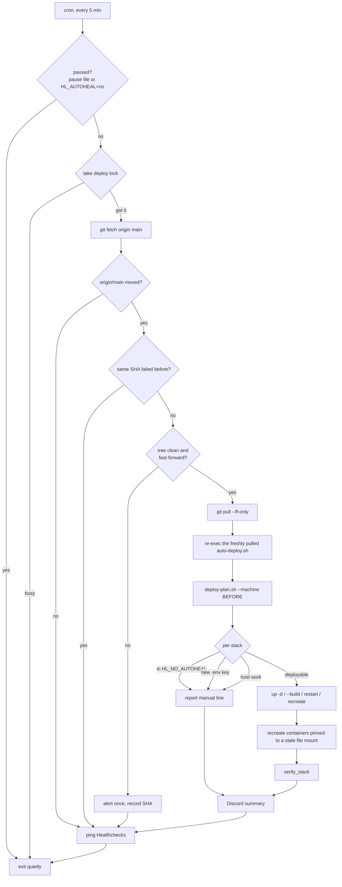

# TSD: Deploy to CT 100 automatically after a merge

**Status:** 🚧 built 2026-11-08, waiting on first install on CT 100 — tracked in #335, decision record [`decisions/0001-auto-deploy.md`](../../decisions/0001-auto-deploy.md)
**Date:** 2026-11-08
**Owner:** Anthony

## Problem

Cloud Claude sessions can't reach CT 100, so every merged homelab PR waits for
someone to run `/deploy` by hand. `scripts/repo-sync.sh` already pulls and heals
stale stacks, but only once a day at 04:00, so a merge can take up to 24 hours
to go live. In the meantime the repo says one thing and the box runs another.

## What you'll see

- You merge a homelab PR. Within about 10 minutes CT 100 is running it.
- Discord gets one message per deploy: the short SHA and commit subject, the
  stacks it touched, and whether verify passed. A failed verify is an alert.
- A merge that touches `proxy` or `matterbridge` deploys nothing for those
  stacks. Instead the message carries the exact manual line to run.
- A merge that needs something only you can do, like a new `.env` key or a
  host-side change, names it and skips that stack.
- Nothing is posted when nothing merged. A quiet channel means nothing changed.
- `/deploy` by hand still works exactly as it does today.

## Approach

A new `scripts/auto-deploy.sh` runs from cron every 5 minutes. It is a thin
driver over code that already exists. It doesn't get its own copy of the rules.

### The pieces

1. **One rule source: `deploy-plan.sh --machine <rev>`.** Today
   `deploy-plan.sh` prints commands for a person to read. A new `--machine`
   flag prints the same plan as one line per action (`stack`, `action`), where
   the action is `up`, `build`, `restart <svc>`, `recreate`, `cron`,
   `manual proxy` or `manual host`. Both outputs come from the same `plan_for`
   rules, so the human plan and the automatic one can't drift apart.
   `auto-deploy.sh` never parses the human text.

2. **Shared helpers move to `scripts/deploy-common.sh`.** `verify_stack`,
   `running_ids`, `job_only`, `in_list`, the JSON helpers and the lock path move
   out of `repo-sync.sh` into one file that both scripts source. This is a move
   with no behaviour change, so repo-sync's nightly run is the regression test.
   The stale file-mount check stays where it was: repo-sync keeps its `docker
   cp` metric loop untouched, and auto-deploy runs `/deploy` step 4's
   `/proc/<pid>/root` check, which is the one that can fail (built narrower than
   drafted, to keep the repo-sync change to a pure move).

3. **One lock.** Everything that deploys takes `flock` on
   `/run/lock/homelab-deploy.lock`. `auto-deploy.sh` uses `flock -n` and exits
   quietly if it's busy, since the next tick is 5 minutes away. `repo-sync.sh`
   waits up to 30 minutes for it. A manual `/deploy` is covered by Decision 1.

4. **Run the script that was just pulled.** `sh` reads a script while running
   it, so a pull that rewrites `auto-deploy.sh` could corrupt the run in
   progress. After the pull the script re-execs itself (`exec "$0" --after-pull
   "$BEFORE"`) with the lock fd kept open, so the rest of the run is the new
   code reading the new rules.

5. **Skipped, never guessed.**
   - Stacks in `HL_NO_AUTOHEAL` (`proxy matterbridge` by default): reported with
     the exact `hl-ssh` line.
   - A key the merged range added to a stack's `.env.example` that its `.env`
     lacks: the key name, never the value, is reported and that stack is
     skipped. Only new keys, since many keys are optional and blank on purpose.
   - `scripts/host/` changes: reported with the line `deploy-plan.sh` already
     prints.
   - A stack with no running containers: left stopped and reported. Stopped
     may be deliberate (a drive not fitted yet), and starting it is a person's
     call. Added while building.
   - `install-cron.sh` runs when `scripts/` changed. It's idempotent and never
     rewrites an existing entry, so this is safe unattended.

6. **Verify.** Each deployed stack goes through `verify_stack`: as many
   containers running as before, none restarting. Decision 2 asks whether to
   also fail on `unhealthy`.

7. **Failure handling.** A failed verify, a dirty tree or a non-fast-forward
   pull alerts once and records that SHA in
   `/var/lib/homelab/auto-deploy/last-failed`. Later ticks skip that SHA until
   `main` moves or a manual `/deploy` clears the file. There's no automatic
   rollback. A revert PR is the rollback, and auto-deploy picks it up like any
   other merge (#254 stays the place for real rollback).
   Each plan covers everything since the last commit that deployed cleanly
   (`last-good`), not just the newest pull, so a stack that failed is retried
   with the next merge instead of being forgotten. A run that dies part-way
   (reboot, hung compose) is finished on the next tick: `last-good` behind
   `HEAD` with no failure recorded means a deploy never completed.

8. **Pause.** Touching `/var/lib/homelab/auto-deploy.pause` stops auto-deploy
   without editing cron. The existing `HL_AUTOHEAL=no` pauses it too, so one
   switch stops every unattended restart. The pause file lives outside the repo,
   so it never makes the tree dirty.

9. **Watching the watcher.**
   - Healthchecks: each run pings `HEALTHCHECKS_AUTO_DEPLOY_URL` (5-minute
     period, 30-minute grace, since repo-sync can hold the lock a while). Until that key is set the script runs unarmed and
     says so, the same as the other jobs through `scripts/healthchecks.sh`.
   - Metrics: `auto_deploy.prom` in the node-exporter textfile directory: the
     last run that reached a decision, behind/paused/failed gauges, and the
     last clean deploy. `hl-auto-deploy-stale` fires when no run has reached a
     decision for 30 minutes (a dead timer, a stuck lock, a fetch that keeps
     failing). Built narrower than first drafted: a "behind main for 30
     minutes" alert would re-page every failure Discord already reported once,
     which the one-alert-per-commit rule forbids.

10. **Discord.** It uses the existing `DISCORD_ALERT_WEBHOOK`, the same channel
    repo-sync reports to. Success is a plain message and a failure is an alert.
    There's no new secret.

### Files touched (build PR)

| File | Change |
|---|---|
| `scripts/auto-deploy.sh` | new |
| `scripts/deploy-common.sh` | new: helpers moved out of `repo-sync.sh` (next to `metrics.sh` so CI's `sh -n scripts/*.sh` covers it) |
| `scripts/repo-sync.sh` | sources the lib, takes the lock |
| `scripts/deploy-plan.sh` | `--machine` output from the same rules |
| `scripts/install-cron.sh` | `*/5 * * * *` auto-deploy entry |
| `docker/monitoring/.env.example` | `HEALTHCHECKS_AUTO_DEPLOY_URL=` |
| `docker/monitoring/grafana/provisioning/alerting/rules.yml` | `hl-auto-deploy-stale` |
| `.claude/commands/deploy.md` | lock / pause step (Decision 1), clears `last-failed` |
| `AGENTS.md`, `docs/setup-log.md` | how deploys work now |
| `scripts/test-deploy-plan.sh`, `scripts/test-auto-deploy.sh`, CI | the machine plan, and the policy end to end against a fake `docker` |

## Rejected

- **Make `repo-sync.sh` run every 5 minutes.** It pulls images, prunes and
  checks staleness. That's too heavy to run 288 times a day, and its 04:00
  report would turn into noise.
- **A self-hosted GitHub Actions runner.** It gives GitHub root-level code
  execution on the box and needs upkeep. Out of scope per #335.
- **A GitHub webhook.** It needs a public endpoint into the lab. Ruled out.
- **Watchtower and similar tools.** They follow image tags, not this repo's
  config, and know nothing about file mounts, `--build` or `proxy`.
- **Parsing `deploy-plan.sh`'s human output.** It would break the first time
  someone rewords a line.
- **Automatic rollback.** It isn't safe for `core` (one-way migrations) or
  `monitoring`. #254 owns that question.

## Cost

- **Build:** size M. Two new files, one refactor, and doc and CI updates.
- **Running cost:** $0. A `git fetch` every 5 minutes is a few KB. Healthchecks
  stays within the free tier (one more check).
- **Maintenance:** one more cron job and one more Healthchecks check. The rules
  stay in one place (`plan_for`), so a new deploy rule is still a one-place
  change.
- **Your one-time steps:** create the `auto-deploy` check in Healthchecks and
  put its URL in `docker/monitoring/.env`. Then run one manual `/deploy`, which
  installs the cron entry.

## Decisions

Settled on #335 (2026-11-03): 5-minute polling, a new `scripts/auto-deploy.sh`,
`HL_NO_AUTOHEAL` stacks report-only, no webhook.

Accepted by Anthony on 2026-11-08 ("1A 2A"):

1. **Manual `/deploy` vs auto-deploy:** `/deploy` writes a pause marker with a
   timestamp, and auto-deploy honours it for 30 minutes, after which it expires
   on its own. Relying on the lock alone was rejected because `/deploy` runs as
   many separate commands and can't hold a lock across them.
2. **Verify fails on `unhealthy`:** `verify_stack` also fails when a container
   in the stack reports `health=unhealthy`, so repo-sync's nightly heal gets
   the same check.

## Out of scope

Self-hosted runners, webhooks, running Claude on the box, automatic rollback,
and holding deploys for CI on `main`, which already gates the merge.
