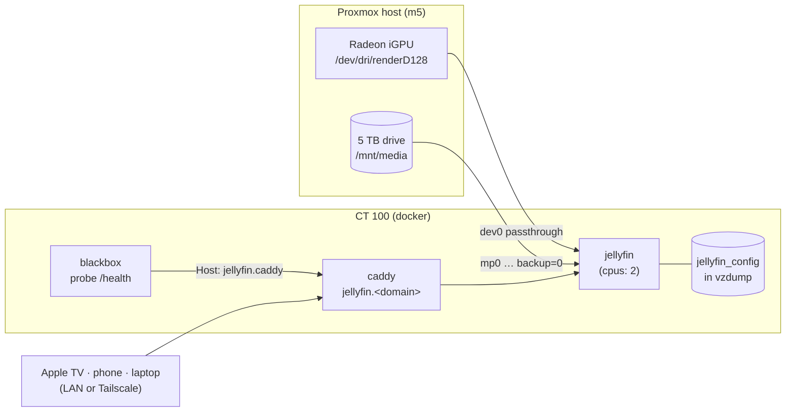

# TSD: Jellyfin, with the iGPU doing the transcoding

**Status:** 📝 draft, awaiting approval. Phases 1–2 need no drive; phase 3 waits
on the 5 TB drive (ordered 2026-10-10).
**Date:** 2026-10-10
**Owner:** Anthony

## The one-paragraph version

Jellyfin runs as a Docker stack in CT 100 (`docker/jellyfin/`), reached at
`jellyfin.<domain>` over the LAN and Tailscale like every other service here.
It is never on the Cloudflare tunnel. Its library lives on the 5 TB drive,
mounted with `backup=0`; its own small config is in the nightly backup. The one
real piece of engineering is **hardware transcoding**. When a phone or browser
can't play a file as-is, Jellyfin converts it on the fly. On the CPU that would
take the whole 6-core quota away from Ollama and everything else. On the
Ryzen's built-in Radeon GPU it costs almost nothing. So the GPU gets passed
through first, and it needs no drive and no media to do it.

**Scope:** the server, playback, storage, access and monitoring. How media gets
onto the drive is out of scope. The library is for media you own: discs you
digitize, home videos, public-domain and DRM-free purchases.

## Goals

1. Watch the library on the TV, phone and laptop, at home and away over
   Tailscale.
2. **Never degrade the rest of the lab.** A transcode or a library scan must
   not starve Ollama, Home Assistant or the assistant bot.
3. Nothing new reachable from the internet, and nothing new to pay for.

## Non-goals

- **Acquiring media.** No download clients, indexers or VPN tunnels in this
  design.
- **Public sharing.** Family members away from home join the tailnet; they
  don't get a public URL. (Cloudflare's terms are why it isn't tunnelled,
  `AGENTS.md` → "Networking rules".)
- **HDR tone mapping at scale.** The iGPU handles it poorly. HDR files are
  played directly on devices that support HDR. See Transcoding.

## Architecture



## Design

### 1. GPU passthrough (Proxmox host → CT 100 → container)

The 7730U's integrated GPU (Radeon, Vega 8 class) does hardware H.264 and HEVC
decode and encode through VA-API. Passing it into a privileged LXC is one line
on the host, and Proxmox 9 supports it directly:

```bash
# on the Proxmox host; the render node only, never the whole /dev/dri
pct set 100 -dev0 /dev/dri/renderD128,gid=$(getent group render | cut -d: -f3)
pct reboot 100      # takes the whole lab down for ~1 minute; pick the moment
```

Then in CT 100, prove it before Jellyfin exists:
`ls -l /dev/dri/renderD128`, and `vainfo` from a throwaway container. Both
should list H.264 and HEVC encode profiles.

- **`pct reboot 100` restarts every stack**, including `proxy`, and the house's
  DNS goes with it for about a minute. Do it at a quiet time and check DNS
  with two `dig`s afterwards (`.claude/commands/deploy.md`).
- **Ollama does not use this GPU.** ROCm does not support this iGPU, so the GPU
  is Jellyfin's alone and Ollama's CPU pinning stays exactly as it is.
- **What it can't do:** AV1 (the iGPU predates it) and good HDR→SDR tone
  mapping. Both fall back to the CPU, so they're limited by the container's
  CPU cap below.

### 2. The stack (`docker/jellyfin/`)

- **Image:** `jellyfin/jellyfin`, pinned to a version tag with Renovate
  updating it, like `proxy` (`tsd-dependency-updates.md`). A media server that
  updates itself overnight is how a Saturday film fails to play.
- **CPU and memory caps:** `cpus: 2`, `mem_limit: 2g`. Library scans,
  thumbnail generation and any CPU fallback stay inside two of the six cores,
  so Ollama's four (`AGENTS.md` → Ollama) are never taken. Scheduled tasks
  (scans, trickplay images) run at 03:30, after the Sunday restore test and
  before `repo-sync.sh` at 04:00.
- **Volumes:**

  | Mount | Where | Backed up |
  |---|---|---|
  | `/config` (users, watch history, settings) | named volume `jellyfin_config` | ✅ in vzdump |
  | `/cache` (transcodes, image cache) | `/media/jellyfin/cache` on the 5 TB drive | ❌ no; rebuildable, and can grow to tens of GB |
  | `/media` (the library), **read-only** | `/media/jellyfin/library` | ❌ `backup=0` |

  The cache lives on the media drive so transcodes never land in the nightly
  vzdump or on the thin pool. The library is mounted read-only: Jellyfin has no
  reason to write there, so it can't damage it.
- **Network:** its own `jellyfin` network, which Caddy and blackbox join.
  **No published ports**: everything goes through Caddy, as Open WebUI does.
  Client auto-discovery (UDP 7359) is not exposed; apps are given the URL once.
- **Accounts:** Jellyfin's own users. One admin, plus a user per person.
  Tailscale is the network boundary; Jellyfin's login is the app boundary.

### 3. Storage (when the 5 TB drive arrives)

Follow `tsd-backups-and-monitoring.md` Phase 1 step 7. The drive is mounted on
the host at `/mnt/media` and into CT 100 with **`backup=0`**:

```bash
pct set 100 -mp0 /mnt/media,mp=/media,backup=0
pct config 100 | grep mp0      # must show backup=0
```

```
/media/
├── jellyfin/
│   ├── library/   movies/ · shows/ · home-videos/ · music/
│   └── cache/
└── photos/        (tsd-photo-library.md)
```

Naming follows Jellyfin's conventions, `Movie Title (Year)/Movie Title (Year).mkv`
and `Show/Season 01/Show S01E01.mkv`, so metadata matches without editing.

### 4. Access

- **Caddy:** `jellyfin.{$HOMELAB_DOMAIN}, http://jellyfin.caddy { reverse_proxy jellyfin:8096 }`.
  The second address is for the probe, the same pattern as `ha.`, and
  `check-probes.sh` enforces it.
- **Clients:** the official Jellyfin apps on iPhone and Android, and
  **Swiftfin** or **Infuse** on Apple TV. Infuse direct-plays the most formats,
  so it transcodes least. On the road, Tailscale on the phone is all that's
  needed.
- **Away-from-home quality:** the default remote bitrate is lowered (8 Mbps) so
  playback over Tailscale on mobile data is smooth, and that's the case the
  GPU transcodes for.

## Monitoring

Per the `alerting` skill:

- **Blackbox probe** of `http://jellyfin.caddy/health` through Caddy (Jellyfin
  answers `Healthy`, 200). That one probe tests the route and the app.
- **Heartbeat:** `jellyfin` is added to `REQUIRED` in `heartbeat.sh`, so a
  stopped container alerts.
- **Dashboard tile** under a new *Media* group, with the vendored Jellyfin icon
  (`scripts/update-tile-icons.sh`).
- **GPU in use:** a metric for whether `/dev/dri/renderD128` is present inside
  the container (`homelab_jellyfin_gpu_present`), with an alert if it vanishes.
  A host kernel update or a lost `dev0` line would silently send every
  transcode to the CPU, and the first symptom would be a slow lab, not a
  failed check.

## Phases

| Phase | Needs | What |
|---|---|---|
| 1 | nothing | GPU passthrough to CT 100; prove it with `vainfo`. One `pct reboot 100`, at a quiet time. |
| 2 | Phase 1 | `docker/jellyfin/` stack, Caddy route, probe, heartbeat, tile, GPU metric. Jellyfin runs with an empty library; set up users and clients. |
| 3 | 5 TB drive | Mount with `backup=0`, create the folder layout, point the libraries at it, test a transcode over Tailscale on mobile data. |

## Rejected alternatives

- **Plex.** Hardware transcoding needs a paid Plex Pass, and sign-in goes
  through Plex's servers. Jellyfin does both for free, locally.
- **A separate LXC for Jellyfin.** Cleaner isolation, but a second container to
  patch, monitor and back up, plus a second GPU passthrough. The CPU and memory
  caps get the isolation that matters inside CT 100.
- **CPU-only transcoding.** It works, but one 1080p transcode can use the whole
  two-core cap, and a 4K one can't keep up at all.
- **Cloudflare Tunnel for remote access.** Covered in `AGENTS.md` → "Networking
  rules"; Tailscale already does the job.

## Open questions

- [ ] **Which TV device?** Apple TV with Infuse direct-plays almost everything,
      so the GPU barely works. A smart TV's built-in app transcodes much more.
- [ ] **Who else watches?** Each person away from home needs Tailscale. One
      tailnet invite each is fine for family; it is the reason this design
      doesn't suit sharing beyond that.
- [ ] **Music in Jellyfin too, or not?** It changes nothing in this design;
      it's one more library folder.
