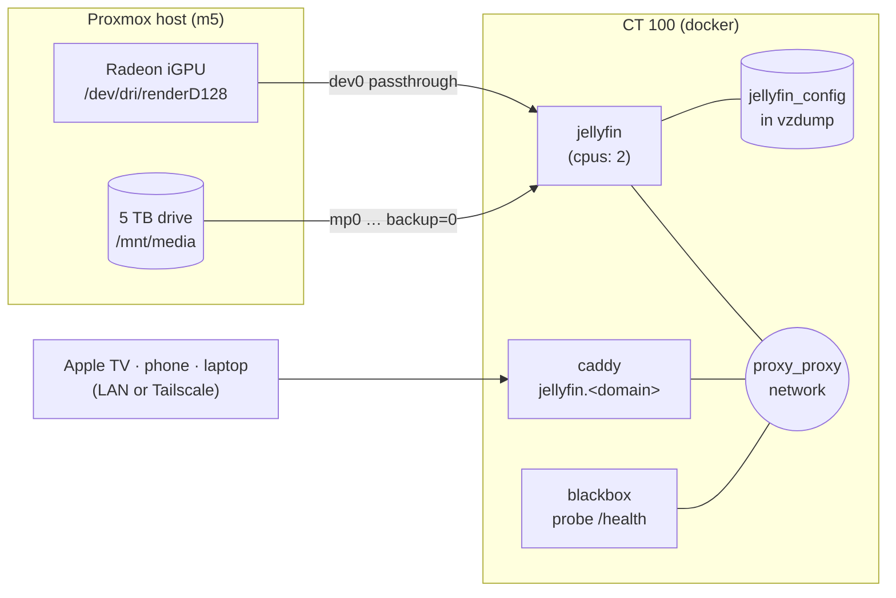

# TSD: Jellyfin, with the iGPU doing the transcoding

**Status:** ✅ approved 2026-10-10; 🚧 stack built (`docker/jellyfin/`), deployed on
drive day. Phase 1 (GPU) can be done now. See [Revisions](#revisions) for what
building it changed.
**Date:** 2026-10-10
**Owner:** Anthony

## The one-paragraph version

Jellyfin runs as a Docker stack in CT 100 (`docker/jellyfin/`), reached at
`jellyfin.<domain>` over the LAN and Tailscale like every other service here.
It is never on the Cloudflare tunnel. Its library lives on the 5 TB drive,
mounted with `backup=0`; its own small config is in the nightly backup. The one
real piece of engineering is **hardware transcoding**. When a phone or browser
can't play a file as-is, Jellyfin converts it on the fly. On the CPU that would
take the whole 6-core quota away from Ollama and everything else. On the
Ryzen's built-in Radeon GPU it costs almost nothing. So the GPU gets passed
through first, and it needs no drive and no media to do it.

**Scope:** the server, playback, storage, access and monitoring. How media gets
onto the drive is out of scope. The library is for media you own: discs you
digitize, home videos, public-domain and DRM-free purchases.

## Goals

1. Watch the library on the TV, phone and laptop, at home and away over
   Tailscale.
2. **Never degrade the rest of the lab.** A transcode or a library scan must
   not starve Ollama, Home Assistant or the assistant bot.
3. Nothing new reachable from the internet, and nothing new to pay for.

## Non-goals

- **Acquiring media.** No download clients, indexers or VPN tunnels in this
  design.
- **Public sharing.** Family members away from home join the tailnet; they
  don't get a public URL. (Cloudflare's terms are why it isn't tunnelled,
  `AGENTS.md` → "Networking rules".)
- **HDR tone mapping at scale.** The iGPU handles it poorly. HDR files are
  played directly on devices that support HDR. See Transcoding.

## Architecture



## Design

### 1. GPU passthrough (Proxmox host → CT 100 → container)

The 7730U's integrated GPU (Radeon, Vega 8 class) does hardware H.264 and HEVC
decode and encode through VA-API. Passing it into a privileged LXC is one line
on the host, and Proxmox 9 supports it directly:

```bash
# on the Proxmox host; the render node only, never the whole /dev/dri
pct set 100 -dev0 /dev/dri/renderD128,gid=$(getent group render | cut -d: -f3)
pct reboot 100      # takes the whole lab down for ~1 minute; pick the moment
```

Then in CT 100, prove it before Jellyfin exists:
`ls -l /dev/dri/renderD128`, and `vainfo` from a throwaway container. Both
should list H.264 and HEVC encode profiles.

- **`pct reboot 100` restarts every stack**, including `proxy`, and the house's
  DNS goes with it for about a minute. Do it at a quiet time and check DNS
  with two `dig`s afterwards (`.claude/commands/deploy.md`).
- **Ollama does not use this GPU.** ROCm does not support this iGPU, so the GPU
  is Jellyfin's alone and Ollama's CPU pinning stays exactly as it is.
- **What it can't do:** AV1 (the iGPU predates it) and good HDR→SDR tone
  mapping. Both fall back to the CPU, so they're limited by the container's
  CPU cap below.

### 2. The stack (`docker/jellyfin/`)

- **Image:** `jellyfin/jellyfin`, pinned to a version tag with Renovate
  updating it, like `proxy` (`tsd-dependency-updates.md`). A media server that
  updates itself overnight is how a Saturday film fails to play.
- **CPU and memory caps:** `cpus: 2`, `mem_limit: 2g`. Library scans,
  thumbnail generation and any CPU fallback stay inside two of the six cores,
  so Ollama's four (`AGENTS.md` → Ollama) are never taken. Scheduled tasks
  (scans, trickplay images) run at 03:30, after the Sunday restore test and
  before `repo-sync.sh` at 04:00.
- **Volumes:**

  | Mount | Where | Backed up |
  |---|---|---|
  | `/config` (users, watch history, settings) | named volume `jellyfin_config` | ✅ in vzdump |
  | `/cache` (transcodes, image cache) | `/media/jellyfin/cache` on the 5 TB drive | ❌ no; rebuildable, and can grow to tens of GB |
  | `/media` (the library), **read-only** | `/media/jellyfin/library` | ❌ `backup=0` |

  The cache lives on the media drive so transcodes never land in the nightly
  vzdump or on the thin pool. The library is mounted read-only: Jellyfin has no
  reason to write there, so it can't damage it.
- **Network:** Jellyfin **joins the existing `proxy_proxy` network**, where
  Caddy and blackbox already are. Not the other way round: Caddy attaches to
  other stacks' networks as `external`, and a missing external network stops
  the `proxy` stack from starting, taking AdGuard and the house's DNS with it.
  This way the dependency points at the stack that is always up.
  **No published ports**: everything goes through Caddy, as Open WebUI does.
  Client auto-discovery (UDP 7359) is not exposed; apps are given the URL once.
- **Accounts:** Jellyfin's own users. One admin, plus a user per person.
  Tailscale is the network boundary; Jellyfin's login is the app boundary.

### 3. Storage (when the 5 TB drive arrives)

Follow `tsd-backups-and-monitoring.md` Phase 1 step 7. The drive is mounted on
the host at `/mnt/media` and into CT 100 with **`backup=0`**:

```bash
pct set 100 -mp0 /mnt/media,mp=/media,backup=0
pct config 100 | grep mp0      # must show backup=0
```

```
/media/
├── jellyfin/
│   ├── library/   movies/ · shows/ · home-videos/ · music/
│   └── cache/
└── photos/        (tsd-photo-library.md)
```

Naming follows Jellyfin's conventions, `Movie Title (Year)/Movie Title (Year).mkv`
and `Show/Season 01/Show S01E01.mkv`, so metadata matches without editing.

### 4. Access

- **Caddy:** `jellyfin.{$HOMELAB_DOMAIN} { reverse_proxy jellyfin:8096 }`.
- **Clients:** the official Jellyfin apps on iPhone and Android, and
  **Swiftfin** or **Infuse** on Apple TV. Infuse direct-plays the most formats,
  so it transcodes least. On the road, Tailscale on the phone is all that's
  needed.
- **Away-from-home quality:** the default remote bitrate is lowered (8 Mbps) so
  playback over Tailscale on mobile data is smooth, and that's the case the
  GPU transcodes for.

## Monitoring

Per the `alerting` skill:

- **Blackbox probe** of `http://jellyfin:8096/health` (Jellyfin answers
  `Healthy`, 200), in the generic `blackbox` job, so `hl-probe-down` pages for
  it by name.
- **Container stopped:** automatic. `heartbeat.sh` reads every
  `container_name` from the compose files into `homelab_container_running`, so
  Jellyfin is watched the moment its compose file is committed. (`REQUIRED` is
  only for the monitoring stack itself.)
- **Dashboard tile** under a new *Media* group, with the vendored Jellyfin icon
  (`scripts/update-tile-icons.sh`).
- **GPU passthrough present:** `homelab_jellyfin_gpu_present` reports whether
  `/dev/dri/renderD128` exists **in CT 100**, from `heartbeat.sh`, once
  `docker/jellyfin/.env` exists there. `hl-jellyfin-gpu-missing` alerts if it
  vanishes, which is what a host kernel update or a lost `dev0` line does.
  It is checked in CT 100 rather than inside the container: a running container
  keeps the node it started with, so an in-container check would stay green
  after the passthrough was gone, and a `docker exec` could hang the heartbeat
  before its off-box ping.

## Phases

| Phase | Needs | What |
|---|---|---|
| 1 | nothing | GPU passthrough to CT 100; prove it with `vainfo`. One `pct reboot 100`, at a quiet time. |
| 2 | built | `docker/jellyfin/` stack, Caddy route, probe, tile, GPU metric and alert, Renovate rule. **Merged and started on drive day:** the stack refuses to start without the drive (see Revisions), and once merged the container inventory expects it running. |
| 3 | 5 TB drive + phases 1–2 | Mount with `backup=0`, create the folder layout, start the stack, recreate `caddy`, set up users, libraries and VA-API, test a transcode over Tailscale on mobile data. Steps in `docker/jellyfin/README.md`. |

## Rejected alternatives

- **Plex.** Hardware transcoding needs a paid Plex Pass, and sign-in goes
  through Plex's servers. Jellyfin does both for free, locally.
- **A separate LXC for Jellyfin.** Cleaner isolation, but a second container to
  patch, monitor and back up, plus a second GPU passthrough. The CPU and memory
  caps get the isolation that matters inside CT 100.
- **CPU-only transcoding.** It works, but one 1080p transcode can use the whole
  two-core cap, and a 4K one can't keep up at all.
- **Cloudflare Tunnel for remote access.** Covered in `AGENTS.md` → "Networking
  rules"; Tailscale already does the job.

## Open questions

- [ ] **Which TV device?** Apple TV with Infuse direct-plays almost everything,
      so the GPU barely works. A smart TV's built-in app transcodes much more.
- [ ] **Who else watches?** Each person away from home needs Tailscale. One
      tailnet invite each is fine for family; it is the reason this design
      doesn't suit sharing beyond that.
- [ ] **Music in Jellyfin too, or not?** It changes nothing in this design;
      it's one more library folder.

## Revisions

Building phase 2 changed three things in this design (2026-10-10):

1. **Network direction.** The draft had Caddy and blackbox joining a new
   `jellyfin` network. That would have made the `proxy` stack fail to start
   whenever Jellyfin's network didn't exist, taking the house's DNS with it.
   Jellyfin joins `proxy_proxy` instead.
2. **No empty-library phase.** The media mounts use `create_host_path: false`,
   so the stack refuses to start until the 5 TB drive is mounted. Otherwise
   Docker would quietly create `/media/jellyfin` on CT 100's rootfs, on the thin
   pool and inside every vzdump, and the transcode cache would grow there. Users
   and clients are set up on drive day instead.
3. **Monitoring.** The probe goes straight to `jellyfin:8096/health` rather
   than through a `jellyfin.caddy` alias. Stopped-container alerting comes
   from the existing container inventory, not from `REQUIRED`. The GPU check
   moved from inside the container to CT 100 after review (see Monitoring).

Tested against `jellyfin/jellyfin:12.2` in a real Docker daemon. The stack
refused to start without `RENDER_GID` and without the media directories, and
did not create them. With them present it came up healthy, `/health` answered
200 over `proxy_proxy`, the CPU and memory caps applied, no host port was
published, and the library was read-only.
