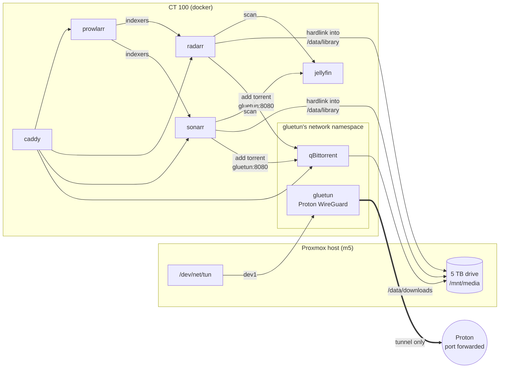

# TSD: Downloads into Jellyfin, only through the VPN

**Status:** 🚧 built 2026-10-11 (`docker/downloads/`), not yet deployed. Waits
on `/dev/net/tun` in CT 100 and the Proton key in `.env`. Steps:
[`docker/downloads/README.md`](../../docker/downloads/README.md).
**Date:** 2026-10-11
**Owner:** Anthony

## The one-paragraph version

A `docker/downloads/` stack in CT 100: **gluetun** holds a Proton VPN
WireGuard tunnel, **qBittorrent** lives inside gluetun's network namespace
and has no other way out, and **Sonarr**, **Radarr** and **Prowlarr** search,
download and file shows and movies onto the 5 TB drive, where Jellyfin finds
them. Finished downloads are **hardlinked** into the library, not copied. All
four web UIs are behind Caddy on the LAN and tailnet like everything else, and
nothing is forwarded on the router: the inbound port a torrent client needs is
forwarded by Proton at the VPN's end.

`tsd-jellyfin.md` made acquiring media a non-goal. This is that, as its own
design, so Jellyfin's stays small.

**Scope:** the plumbing. Which indexers are added, and what is downloaded, is
the owner's decision and the owner's legal question. The repo ships no
indexers.

## Goals

1. Ask for a show or movie once; it arrives in Jellyfin without more steps.
2. **Never on the home connection.** If the tunnel is down, the torrent client
   is offline, by construction rather than by a setting.
3. **Never degrade the rest of the lab**: CPU and memory capped, nothing on the
   thin pool, nothing in the nightly vzdump but the apps' small configs.
4. Nothing new reachable from the internet.

## Non-goals

- **Usenet.** Torrents only for now. SABnzbd would slot in beside qBittorrent
  later, in the same namespace.
- **Requests from other people** (Jellyseerr). One user; Sonarr and Radarr are
  the request UI.
- **A VPN for anything else** in the lab. Only qBittorrent is inside it.

## Architecture

### Why gluetun and a shared namespace

`network_mode: service:gluetun` gives qBittorrent gluetun's network stack and no
other. gluetun's firewall allows only the tunnel out (plus replies to the local
Docker network, which is how Caddy and Sonarr reach it). There is no kill
switch to configure or forget: when the tunnel is down there is no route at
all. The alternative, a VPN client inside qBittorrent's own container or a
"bind to interface" setting alone, fails open the day the setting is lost.

The cost is a Docker quirk: qBittorrent is attached to the namespace of a
specific gluetun container. If gluetun is restarted or recreated alone,
qBittorrent keeps the dead namespace and has no network. Compose handles its own
side: `depends_on: {gluetun: {restart: true}}` restarts qBittorrent whenever
Compose replaces gluetun. What it cannot see is the daemon restarting gluetun
after a crash, or a manual `docker restart gluetun`; the qBittorrent probe
going red while gluetun's stays green is exactly that state, and the fix is
recreating the stack (README → Troubleshooting).

### Why only qBittorrent is inside

Sonarr, Radarr and Prowlarr fetch metadata and talk to indexers' APIs; they
never move file content. Inside the tunnel they would go unreachable every
time it reconnects, and Proton changes the forwarded port on each reconnect.

### Proton and port forwarding

Proton VPN Plus forwards one inbound port per connection (NAT-PMP). Without
one, peers cannot connect in and torrents with few seeders barely move. gluetun
requests it (`VPN_PORT_FORWARDING=on`, `PORT_FORWARD_ONLY=on`) and runs
`VPN_PORT_FORWARDING_UP_COMMAND` with each new port, which posts it to
qBittorrent's API on localhost. That needs qBittorrent's "bypass
authentication for clients on localhost", which only the shared namespace
counts as localhost. Mullvad, otherwise a good provider, dropped port
forwarding in 2023 and was ruled out for that reason. The Proton free plan
blocks P2P.

### Storage and hardlinks

| Path in container | Host (CT 100) | Who sees it |
|---|---|---|
| `/data/downloads` | `/media/jellyfin/downloads` | qBittorrent, Sonarr, Radarr |
| `/data/library` | `/media/jellyfin/library` | Sonarr, Radarr (read-write); Jellyfin read-only as `/media` |

Sonarr and Radarr mount the whole of `/media/jellyfin` as `/data`, so a download
and its library place share one filesystem and one mount, and an import is a
hardlink: instant, no second copy, and the torrent keeps seeding the same
blocks. Every bind has `create_host_path: false`, as Jellyfin's do, so a
missing drive stops the stack instead of filling the thin pool.

The drive is `backup=0`, so downloaded media has no backup by design. The
apps' configs (named volumes) are in the nightly vzdump.

## Exposure

`torrent.`, `sonarr.`, `radarr.` and `prowlarr.` on `$HOMELAB_DOMAIN`, through
Caddy, LAN and tailnet only, each with its own login. Never on the Cloudflare
tunnel. No published ports. The stack joins `proxy_proxy` rather than Caddy
joining a downloads network, so the proxy stack (and DNS) never depends on it.

## Resources

| Container | cpus | mem |
|---|---|---|
| gluetun | 0.5 | 256m |
| qBittorrent | 1 | 1g |
| sonarr, radarr | 0.5 each | 512m each |
| prowlarr | 0.5 | 256m |

At most 3 CPUs for the stack, and they are ceilings: idle, it uses almost
nothing. Jellyfin is capped at two, Ollama pins four threads (`AGENTS.md` →
Ollama); the sum can exceed CT 100's six only when everything is busy at once,
which the caps keep from being any one stack's fault.

## Monitoring

- **VPN down:** gluetun's health server on `:9999` answers 200 only while the
  tunnel works. A blackbox probe with `service=gluetun` makes that
  `hl-probe-down`, with no new rule.
- **Apps:** probes of each `/ping`, and qBittorrent's web UI via `gluetun:8080`.
- **Stopped containers:** `homelab_container_running`, required once
  `docker/downloads/.env` exists (`SETUP_GATED_STACKS`), silent before.
- **Control server:** gluetun's (`:8000`, which can stop the VPN) is bound to
  localhost, so no other container on `proxy_proxy` reaches it.

## Rollout

| Phase | Needs | What |
|---|---|---|
| 1 | nothing | This PR: stack, routes, probes, tiles, Renovate rule. Merging it pages nothing (gated on `.env`). |
| 2 | Proton VPN Plus key | `pct set 100 -dev1 /dev/net/tun`, folders and ownership, `.env`, `up -d`, prove the egress IP differs from home. README steps 1–3. |
| 3 | phase 2 | qBittorrent, Prowlarr, Sonarr, Radarr configured; one test download imported by hardlink and visible in Jellyfin. README steps 4–5. |

## Open questions

- [ ] Seeding limits (ratio or time) in qBittorrent, so a finished torrent does
      not seed forever. Owner's call; default is unlimited.
