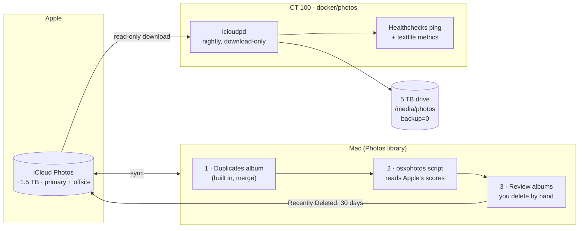

# TSD: A local mirror of iCloud Photos, and a cleanup that keeps it under 2 TB

**Status:** 🚧 Phase 1 built 2026-10-25 (`docker/photos/`), not yet deployed. The
5 TB drive is in; the ISP switch is no longer a prerequisite (see *First sync*).
Archiving off iCloud is now wanted and is an open decision (Open questions).
**Date:** 2026-10-10
**Owner:** Anthony

## The one-paragraph version

iCloud Photos holds about 1.5 TB on the 2 TB plan, and it is the **only copy**.
iCloud is a sync service, not a backup: a deletion, a bad sync or a locked
account takes a photo away everywhere at once. The plan has two halves.
**(1) Mirror:** the homelab downloads every photo nightly to the 5 TB drive and
never deletes anything, which makes it the second copy, while iCloud itself
stays the offsite one. That is 3-2-1 for photos at no new monthly cost.
**(2) Cleanup:** on the Mac, use Apple's own duplicate detection and
quality scores to *propose* deletions into review albums, which you approve by
hand. That keeps the library under 2 TB, because the next iCloud tier is 6 TB
at about three times the price.

## Goals

1. **A second, independent copy of every photo and video**, current to within
   a day, on hardware you own.
2. **Stay on the 2 TB plan** by removing duplicates and junk, without ever
   deleting something you would have kept.
3. Nothing new to pay for each month, and nothing new reachable from the
   internet.

## Non-goals

- **Automatic deletion.** No script deletes a photo. Ever. Scripts propose, you
  decide, and Photos' *Recently Deleted* gives 30 days to change your mind.
- **Archiving off iCloud.** Moving old photos out of iCloud would save nothing
  today (the 2 TB plan is the cheapest that fits) and would make the homelab
  the only copy, which then needs its own backup and paid offsite storage.
  Revisit only if the library approaches 2 TB *after* cleanup. See the
  decision rule below.
- **A model that judges photos.** Apple already scores every photo on the
  device. The cleanup reads those scores; it does not train or run anything.

## Architecture

### Half 1 — the mirror (`docker/photos/`)

- **[`icloudpd`](https://github.com/icloud-photos-downloader/icloud_photos_downloader)**
  in a container, run nightly at **01:00** (before the 02:00 Postgres dump and
  the 02:30 vzdump, so the three never compete for disk).
- **Download only.** `--auto-delete` and `--delete-after-download` are **never**
  set. A photo deleted in iCloud stays in the mirror. That is the point: the
  mirror is what protects you from a deletion you didn't mean. The cost is
  that the mirror keeps what cleanup removes; see Open questions.
- **Layout:** `--folder-structure {:%Y/%m}` under `/media/photos/icloud/`, so
  the files are useful without any software: a folder per month, originals as
  Apple stores them (HEIC, MOV, and the live-photo pairs).
- **Storage:** the 5 TB drive, mounted into CT 100 with **`backup=0`** (see
  `tsd-backups-and-monitoring.md`, Phase 1 step 7). Once anything is deleted from
  iCloud the mirror is the only copy, so it is in the restic → B2 offsite
  backup (`scripts/offsite-backup.sh`, tag `photos`, added 2026-10-31,
  homelab#260): nightly after the lab's data, stopping at 07:00 and at a
  monthly upload budget (`HL_OFFSITE_PHOTOS_MONTHLY_BUDGET_GB`, default 300).
  About $6/TB/month; `HL_OFFSITE_PHOTOS_VIDEOS_ONLY=1` backs up only videos.
- **No ports, no Caddy route.** It only makes outbound requests to Apple.
- **First sync:** about 1.5 TB, and some Xfinity plans cap at about 1.2 TB a
  month. Rather than wait for the Frontier switch, `scripts/photos-sync.sh`
  counts what the container receives and stops at `PHOTOS_MONTHLY_BUDGET_GB`
  (default 500) per calendar month and at `PHOTOS_STOP_HOUR` (default 07:00);
  icloudpd skips what is on disk and resumes partial files, so the backfill
  spreads over about three months by itself. Over budget, runs still fetch the
  last 7 days. After the switch, set the budget to 0.
- **Filenames and metadata:** `--file-match-policy name-id7` puts the iCloud
  asset id in every filename (no collisions, and a file can be traced back to
  its asset), and `--xmp-sidecar` keeps favourites, titles, keywords and
  location beside each file. Both matter most if a photo ever leaves iCloud.

### Half 2 — the cleanup (on the Mac)

The deletions have to happen in Photos, so the tooling runs on the Mac. It
lives in this repo under `tools/photos/`, because the mirror and the cleanup
are one design, but it is run by hand on the Mac, never from cron.

1. **Duplicates, first and free.** Photos → *Duplicates* (macOS Ventura and
   later) finds exact and near duplicates, and *Merge* keeps the best-quality
   copy and combines their metadata. This step alone may be most of what
   "remove duplicates" needs.
2. **Score, then propose.** A Python script using
   [`osxphotos`](https://github.com/RhetTbull/osxphotos) reads what Photos has
   already computed for every photo: overall and aesthetic scores, blur and
   noise, screenshots, bursts and which frame was picked. It works from the
   library's database, so originals do not need to be downloaded to the Mac.
   Rules are code and thresholds, not a model: *Python decides, people approve.*
3. **Review albums.** Candidates go into albums, never into the trash:
   - `Review: duplicates Photos missed` (same capture time and similar score)
   - `Review: unpicked burst frames`
   - `Review: low quality` (blurred or poorly scored, below a threshold)
   - `Review: old screenshots` (older than N months)
   You open each album, select what to delete, and delete it in Photos.
4. **Every run starts as a dry run** that prints counts and estimated bytes per
   album, so the thresholds can be tuned before anything is added.

## Monitoring

Same rules as every other job here (the `alerting` skill):

- **Healthchecks ping** with the exit code, `HEALTHCHECKS_PHOTOS_URL`
  (period 1 day, grace 6 hours). This is the "did it run" signal.
- **Textfile metrics:** time of the last successful sync, photos in the mirror,
  bytes on disk, new items in the last run. A sync that "succeeds" but adds
  nothing for weeks is visible on a panel.
- **Re-authentication is the known failure.** Apple sessions expire. Reports
  say roughly every two months, and Advanced Data Protection adds conditions.
  When it expires, icloudpd fails and Healthchecks pages. The runbook fix is
  one command, `docker compose run --rm icloudpd --auth-only`, which asks for
  the 2FA code. The alert message names that command, so the 4 am page says
  what to do.

## Security

- **The session cookie is the credential.** After the first login, icloudpd
  keeps a session that can read your whole iCloud Photos library. It lives in a
  named volume, never in the repo. That volume is inside CT 100, so it is in
  the nightly vzdump, which is one more reason the backup drive should be
  encrypted (LUKS, `tsd-backups-and-monitoring.md` decision 2).
- **The Apple ID password** is entered interactively by `photos-sync.sh
  --auth` and saved in the session volume (keyrings.alt's plaintext file,
  mode 600), never in `.env` or the repo. The first design kept no password,
  on the assumption that a session lasts months; the first real test run
  (2026-10-30) showed Apple's session token expiring within the hour, after
  which icloudpd needs the password to sign in again. The ~2-month limit is
  the 2FA trust token, not the session. The volume already held a credential
  that reads the whole library, so this adds little.
- **Advanced Data Protection:** if it is on, icloudpd needs *Settings → Apple ID
  → iCloud → Access iCloud Data on the Web* enabled. Turning that on is a real
  trade-off: it reopens web access to the account. Decide it deliberately.

## Storage math

| | Now | In 3 years (est.) |
|---|---|---|
| iCloud library | ~1.5 TB | capped at 2 TB by the plan |
| Mirror on the 5 TB drive | ~1.5 TB | ≤ 2 TB, plus whatever cleanup removed |
| Left for Jellyfin | ~3 TB | ~2–2.5 TB |

## Decision rule for archiving

Revisit archiving only if **after** cleanup the library is above **1.8 TB**. At
that point the choices are: pay for 6 TB (about $30/month), or archive the
oldest years to the homelab and buy offsite storage for that archive (about
$6/TB/month on B2) plus a backup drive large enough to hold a copy of it. Do
the arithmetic then, with the real numbers.

## Phases

| Phase | Needs | What |
|---|---|---|
| 0 | nothing | You: open Photos → *Duplicates* and merge. Note how much it saved. |
| 1 | 5 TB drive ✅ | `docker/photos/` stack, first sync (budgeted), Healthchecks check, metrics, alert. 🚧 built 2026-10-25 |
| 2 | nothing (reads the Mac's library, not the mirror) | `tools/photos/estimate.py` dry-run report: what each category would hold and which iCloud plan the rest fits. 🚧 built 2026-10-25 |
| 3 | You approve thresholds | The script fills the review albums; you delete by hand. |
| 3b | Phase 1's mirror | `tools/photos/climb_judge.py`: send or fall, per climbing clip, by body tracking on the box and by Claude on sampled frames, scored against ~20 clips Anthony labels. Picks which one decides which climbing videos leave iCloud (the rest stay). 🚧 built 2026-10-30 |

## Open questions

- [ ] **Archive the weak photos off iCloud? (wanted, 2026-10-25)** Anthony wants
      the camera roll to hold only good photos, with the rest kept on the
      homelab, ideally ongoing. Doable: the Mac-side script already sorts
      photos by Apple's scores; an archive album would hold only photos it has
      confirmed are in the mirror, and deleting them stays a person's tap.
      What blocks it is the second copy. Off iCloud, the media drive
      (`backup=0`, no offsite yet) would be the only copy, so archiving needs
      the archive in restic → B2 first (about $6/TB/month), or an explicit
      decision to accept one copy. The money only works out if the library
      drops under 200 GB (the $2.99 tier); otherwise the gain is a cleaner
      camera roll. Supersedes the non-goal "Archiving off iCloud" once decided.
- [x] **Where is the rest of the "3 TB of photos"?** Answered 2026-10-25:
      everything is in iCloud, so nothing is waiting without a second copy.
- [ ] **Is Advanced Data Protection on?** See Security.
- [ ] **Should the mirror ever forget?** Download-only keeps every photo you
      delete in cleanup. Options: keep everything forever (simplest, safest),
      or a yearly, manually reviewed prune of files deleted from iCloud more
      than a year ago.
- [ ] **Does the Mac keep originals or "Optimize Mac Storage"?** osxphotos reads
      scores either way; it only matters if a rule ever needs the image itself.

## Rejected alternatives

- **Immich or PhotoPrism as the photo library.** Both are good, but they
  replace Photos rather than back it up, and they bring a database, machine
  learning workers and a web UI to run and patch on a 16 GB box. The goal is a
  second copy, not a second app. They can always be pointed at the mirror later.
- **Running cleanup on the homelab against the mirror.** The homelab can find
  duplicates in files, but it cannot delete anything in iCloud. Deletions have
  to happen in Photos, so the decisions are made where they are carried out.
- **Using a local LLM to judge photo quality.** Apple's on-device scores
  already exist for every photo, cost nothing to read, and a 3B text model
  cannot see images anyway.
