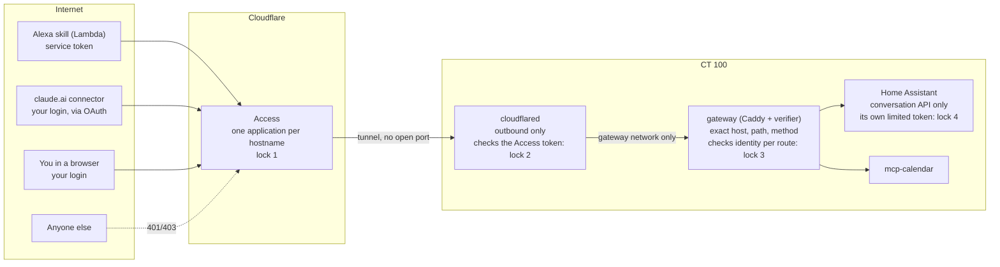

# TSD: One secure gateway for everything the homelab exposes

**Status:** proposed — tracked in #360, decision record [`decisions/0002-secure-gateway.md`](../../decisions/0002-secure-gateway.md)
**Date:** 2026-11-09
**Owner:** Anthony

## Problem

Use cases that need something on CT 100 to be reachable from the internet keep
coming back:

- an Alexa private skill, running in AWS Lambda, that needs Home Assistant's
  conversation endpoint;
- claude.ai connectors (the calendar MCP was public for a while, then removed
  in #348 because it didn't feel safe enough);
- app previews for friends (`fleet:app-preview-deploy`).

Each one so far was designed from scratch, and each one ended with "I don't feel
secure about this". Today the answer is "nothing is public": the tunnel
`homelab` runs with zero routes, and cloud Claude reaches data through a
locked-down Remote Control session instead. That works for Claude, but it can't
work for Alexa, because Lambda can't run a Remote Control session.

What's missing is **one pattern, designed once**, so a new endpoint is a short
checklist instead of a new security argument.

## What you'll see

- Exposing a new endpoint is a pull request that adds one route block and one
  Access application, following a fixed checklist. No new design work.
- Every endpoint has its own unguessable hostname, its own credential and its
  own allowlist of paths. One endpoint's credential opens nothing else.
- Your home IP has no open ports. Port scanners (Shodan, Censys) see nothing.
- `#alerts` in Discord tells you about anything that looks like an attack: a
  request refused at the box, a login from a new country, a credential used
  from somewhere it shouldn't be, a tunnel or Access change you didn't make.
- The morning digest has one line: requests let in, requests refused, routes
  live, credentials expiring.
- One command turns the whole gateway off.

## Approach

### The shape

Four independent locks. An attacker has to beat **all four**, and each is run
by a different piece of software:

1. **Cloudflare Access** in front of each hostname. People sign in with your
   Google account (passkey or 2FA). Machines like the Alexa Lambda present a
   **service token** (`CF-Access-Client-Id` / `CF-Access-Client-Secret`)
   matched by a Service Auth policy. With strict service token authentication,
   a bad or missing token gets a plain `401`/`403`, never a login page.
2. **cloudflared checks the Access token** before it forwards anything
   ("Protect with Access", `originRequest.access.required` with the app's AUD
   tag). If the Access application were ever deleted or misconfigured,
   cloudflared still refuses the request. This is what makes the design
   **fail closed**.
3. **The gateway** (a dedicated Caddy, separate from the LAN Caddy) verifies the
   same token a second time with a small verifier we own (`forward_auth`, about
   80 lines, the same logic as the `access.py` that the calendar used before
   #348). It also checks *who*: each route lists the identities allowed on it,
   so the Alexa token is accepted on the Alexa route and nowhere else. Then it
   matches the exact path and method. Anything not listed is a `404`.
4. **The upstream's own auth, least privilege.** The gateway adds the upstream
   credential itself, from its own `.env`, so it never leaves the box. For Home
   Assistant that's a long-lived token of a dedicated non-admin HA user. The
   Lambda never holds an HA token.

### Where it can and can't reach

- **cloudflared joins one Docker network: `gateway_edge`.** Today it joins
  `core_core` and `ai_ai`. That's removed. cloudflared can reach the gateway and
  nothing else, so a typo in a tunnel route can't land on Portainer.
- **The gateway joins one network per upstream** it serves, and nothing else.
- **A denylist checked in CI.** These never go through the gateway: Actual
  Budget and its MCP, Portainer, Grafana, Prometheus, Proxmox, AdGuard,
  Jellyfin, qBittorrent and the *arr apps, Matterbridge, Kali, and Home
  Assistant's UI or any HA path outside the route's allowlist. CI fails a PR
  whose gateway config points at one of them.

### Staying off the map

- **No inbound ports.** cloudflared dials out to Cloudflare. Nothing listens on
  the home IP, and the public hostnames are CNAMEs to the tunnel, never to the
  home IP. A port scan of the home IP finds nothing, and a scan of Cloudflare
  finds Cloudflare.
- **Not in certificate logs.** Every public certificate is published in
  Certificate Transparency logs, which is how people find subdomains. Gateway
  hostnames are first-level names under `brignano.io`, so they're served by the
  zone's Universal SSL wildcard (`*.brignano.io`). No certificate ever names
  them individually.
- **Not in the repo.** `brignano/homelab` is public. Hostnames live in
  `docker/gateway/.env` on the box. The repo uses route names (`alexa`,
  `calendar`) and `{$GW_HOST_ALEXA}`-style placeholders.
- **Unguessable names.** Each hostname has a random label, like
  `k7q2m9.brignano.io`. A name someone guesses either doesn't exist or answers
  `403`.

To be straight about the limit: a hostname that someone *does* learn will
resolve and answer `401`/`403` from Cloudflare. That tells them only that
something sits behind Cloudflare Access, which is true of a large share of the
web. Being findable isn't the protection. The four locks are. Hiding just cuts
the noise.

### Seeing attacks

Access logs on the free plan are kept for **24 hours**, so the box keeps its own
copy.

| Signal | Source | Goes to |
|---|---|---|
| Any request the gateway refuses (bad token, wrong identity, unknown path) | gateway JSON log, `scripts/gateway-watch.sh` every 5 min | `#alerts` right away. Locks 1–2 should stop everything first, so a refusal here means something got further than it should |
| Successful sign-in from a country or network not seen before | Access logs via Cloudflare API (read-only token), polled every 5 min, kept 90 days | `#alerts` |
| A service token used from outside its expected source (for Alexa: not AWS) | same poller | `#alerts` |
| Failed sign-ins and refused service tokens | same poller | counted in the digest; `#alerts` above a threshold |
| Tunnel down, tunnel created or deleted | Cloudflare Notifications | `#alerts` (webhook) or email |
| Service token expiring | Cloudflare Notifications | `#alerts` or email |
| A certificate issued for `brignano.io` that Cloudflare didn't issue | Cloudflare CT Monitoring (all plans) | email |
| Poller or watcher stopped | Healthchecks ping, like the other jobs | Healthchecks alert |
| Daily totals: let in, refused, routes live, tokens expiring | gateway log + poller | morning digest |

All of it uses the alerting that already exists (`.claude/skills/alerting`,
Discord webhooks, Healthchecks).

**Kill switch:** `scripts/gateway-off.sh` stops cloudflared. Every endpoint is
offline in seconds and nothing else on the box changes.
`scripts/gateway-on.sh` brings it back.

### What this looks like for Alexa

The first endpoint, built after this proposal is accepted, in its own issue:

1. Alexa calls the skill's Lambda. The Lambda checks the request is for your
   skill ID and drops anything else.
2. The Lambda calls `https://<random>.brignano.io/api/conversation/process`
   with the `alexa-lambda` service token in two headers. The token lives in
   Lambda's environment, encrypted.
3. Access matches the Service Auth policy for that token on that hostname only.
4. cloudflared checks the Access token's signature and AUD.
5. The gateway checks the token belongs to `alexa-lambda`, the method is
   `POST`, the path is exactly `/api/conversation/process` and the body is
   under 8 KB. It adds the HA token of the `gateway-alexa` user and forwards to
   `host.docker.internal:8123`.
6. Home Assistant answers with what Assist allows that user to do. Locks,
   alarm and garage stay unexposed to Assist, as today.

A claude.ai connector works the same way with one difference: lock 1 is your
own Google sign-in through Access **Managed OAuth** (what the calendar used
before #348), and the route allows your identity instead of a service token.

## Threat model

| Who or what | What they'd try | What stops them | How you'd know |
|---|---|---|---|
| Internet scanners | Find open ports on the home IP | There are none | — |
| Someone who learns a hostname | Send requests | Lock 1: no login or token, `401`/`403` | Digest count of refusals |
| Someone with a stolen service token (say, from the Lambda config) | Use it | Works only on that one hostname, only on its allowlisted paths and methods, and reaches HA only as a limited user. Rotate the secret in the Cloudflare dashboard in a minute | Poller alert: token used from outside AWS, or unusual volume |
| Someone who takes over your Google account | Sign in through Access | Passkey or 2FA on the Google account. Access sessions short on routes that can change things | Alert: sign-in from a new country or network |
| Someone who takes over your Cloudflare account | Add a route or delete an Access app | Hardware key or 2FA on Cloudflare. Even then, lock 3 rejects tokens from an app the gateway doesn't know, and cloudflared can only reach the gateway | Cloudflare notifications on tunnel changes; audit log |
| **A mistake by us** (the most likely real risk) | A route pointed at the wrong service, or an Access app missing | cloudflared reaches only the gateway; the gateway refuses anything without a valid token for that route; CI denylist; per-endpoint checklist and a fail-closed test | Gateway refusal alerts; the checklist's tests |
| A bug in the upstream (say HA) | Exploit it through the allowed path | Only one or two paths reachable, and only by an authenticated caller. Upstream auto-updates, body-size limits at the gateway | Gateway log |
| Path tricks (`/allowed/../admin`) | Slip past path matching | cloudflared ≥ 2026.10.0 with path normalization on; the gateway matches exact paths after Caddy's own normalization | Gateway refusal alert |
| Flooding | Knock it offline | Cloudflare absorbs it before the home connection. Nothing inbound to saturate | Tunnel health alert |
| Cloudflare itself | Read traffic (TLS ends at Cloudflare) | Accepted. It's why financial data never goes through the gateway | — |

## Why you can trust it

- **It's the standard pattern, not a homemade one.** Cloudflare Access with
  Tunnel is how companies replace VPNs for internal apps. Service tokens and
  origin-side JWT validation are the documented way to let machines in. Docs:
  [validate the Access JWT](https://developers.cloudflare.com/cloudflare-one/access-controls/applications/http-apps/authorization-cookie/validating-json/),
  [cloudflared "Protect with Access"](https://developers.cloudflare.com/tunnel/reference/origin-parameters/#access-settings),
  [service tokens and strict service token auth](https://developers.cloudflare.com/cloudflare-one/access-controls/service-credentials/service-tokens/),
  [Universal SSL wildcard coverage](https://developers.cloudflare.com/ssl/edge-certificates/universal-ssl/),
  [Zero Trust log retention](https://developers.cloudflare.com/cloudflare-one/insights/logs/),
  [tunnel notifications](https://developers.cloudflare.com/cloudflare-one/networks/connectors/cloudflare-tunnel/monitor-tunnels/notifications/).
- **No single lock is trusted.** Locks 1, 2 and 3 are three separate checks
  of the same signed token, by Cloudflare's edge, by cloudflared, and by code
  in this repo. Lock 4 is the upstream's own login.
- **You can test it yourself.** The build's acceptance criteria include these
  checks, and they're repeated in the runbook so you can run them any time:
  - `curl -i https://<host>/` with no credentials answers `401` or `403`.
  - With the right token but a path not on the route: `404` from the gateway,
    and an alert in `#alerts`.
  - With the Alexa token on the calendar hostname: refused, and an alert.
  - **Fail-closed drill:** on a throwaway test route, remove the Access
    application. Requests are still refused by cloudflared and the gateway.
  - [crt.sh](https://crt.sh/?q=brignano.io) lists no gateway hostname.
  - A port scan of the home IP from outside (phone hotspot) finds no open port.
  - A test alert from each source arrives in `#alerts`.

No design makes anything *impossible* to reach. What this one promises is that
every way in is written down, each way has four separate locks, the most likely
failure (our own mistake) fails closed, and every attempt shows up in Discord.

## The per-endpoint checklist

Each new endpoint is one issue and one PR that ticks every line. The runbook
(`docs/runbook-gateway.md`) holds the click-by-click steps.

1. **Is public needed at all?** Prefer LAN/tailnet, or the `life` Remote
   Control pattern for cloud Claude. If either works, stop here.
2. **Not on the denylist.** CI checks this too.
3. **Name the caller.** A person (your login) or a machine (one new service
   token per caller, never shared, 1-year expiry, expiry alert on).
4. **Smallest surface.** List exact paths and methods. Read-only unless writes
   are the point. Set a body-size limit.
5. **Least-privilege upstream credential**, held by the gateway's `.env`, never
   by the caller.
6. **Hostname:** new random first-level label under `brignano.io`, in
   `docker/gateway/.env` only.
7. **Access application** for that hostname, before the DNS route exists:
   policy `Me` or a Service Auth policy for the one token. Short session for
   anything that can change state. 401 response for Service Auth. Copy the AUD
   tag into `.env`.
8. **Tunnel route** for that hostname → `http://gateway:8080`, with "Protect
   with Access" on and the AUD set.
9. **Gateway route block** with the allowed identities, paths, methods and
   upstream.
10. **Run the tests** above for this route, including the fail-closed drill,
    and paste the output in the PR.
11. **Alerts** fire for this route (send one bad request, see it in
    `#alerts`).
12. **Write it down:** setup-log entry, AGENTS.md "Stack overview" row.

The `/expose-service` command is rewritten to walk through this list.

## Alternatives considered

| Option | Why not |
|---|---|
| **Keep nothing public** (today) | Right for Claude and Life (Remote Control), but Alexa can't use it. The gateway doesn't change that default: step 1 of the checklist still prefers it |
| **Port forward + reverse proxy + CrowdSec/fail2ban** | Opens a port on the home IP that every scanner finds within hours. Security depends on the proxy being patched forever |
| **Tailscale Funnel** | Funnel is public to everyone with no identity check in front, so the app's own auth is the only lock. Tailscale also runs only on m5 (the hypervisor), the worst place to expose |
| **Put the client on the tailnet** (Lambda running Tailscale in userspace) | Works for Lambda, but adds a long-lived tailnet key to AWS and gives a cloud function a route into the whole LAN unless ACLs are perfect. claude.ai can't join a tailnet at all |
| **Small VPS + WireGuard relay** | Another server to patch and pay for (~$5/mo). Ends up rebuilding what Access already does |
| **Cloudflare Worker in front, calling the tunnel** | Possible later as an extra filter, but adds code to deploy elsewhere. Not needed for the locks above |
| **Pangolin / self-hosted tunnel controller** | Same idea, but you run and patch the controller yourself. Cloudflare is already in place and free |
| **Access mTLS for machines** instead of service tokens | Stronger, but needs a paid Zero Trust plan. Service tokens plus locks 2–4 are enough here |

## Cost

- Cloudflare Zero Trust **free** plan (up to 50 users; service tokens, tunnel
  and notifications included): $0.
- One more container (Caddy) and one small verifier on CT 100: a few MB of RAM.
- A read-only Cloudflare API token for the log poller.
- Upkeep: Renovate pins the cloudflared and Caddy images. Service tokens are
  refreshed once a year when the expiry alert fires.

The paid plan (about $7 per user per month) would add 30-day log retention and
mTLS. Not needed: the poller keeps 90 days on the box.

## Build plan (after acceptance)

One PR for the gateway itself, then one PR per endpoint.

1. `docker/gateway/`: Caddy with route blocks, the JWT verifier
   (`forward_auth`), JSON access log, `.env.example` with placeholders only.
2. `docker/tunnel/`: join only `gateway_edge`; pin a cloudflared version
   ≥ 2026.10.0 with path normalization on.
3. `scripts/gateway-watch.sh` and `scripts/access-log-poll.sh` (cron, lock,
   Healthchecks ping), digest line, alert wiring.
4. `scripts/gateway-off.sh` / `gateway-on.sh`.
5. CI: denylist and "every route has `forward_auth`" checks.
6. `docs/runbook-gateway.md`, a rewritten `/expose-service`, AGENTS.md
   "Networking rules" and stack table, `docker/tunnel/README.md`.
7. A throwaway `selftest` route to prove the tests and the fail-closed drill,
   removed afterwards.

Your part: create the read-only API token, turn on strict service token
authentication if the org predates it, add the Cloudflare notifications, and
turn on passkeys/2FA on the Google and Cloudflare accounts if they aren't
already.

## Out of scope

- The Alexa skill and its Lambda (next issue, as the first endpoint).
- Re-publishing the calendar for claude.ai. Remote Control stays the way cloud
  Claude reads data unless you ask otherwise.
- Anything for Actual Budget. It stays LAN/tailnet only.
- App previews for friends. They keep their own pattern in
  `fleet:app-preview-deploy` until they need to reach CT 100 services.
