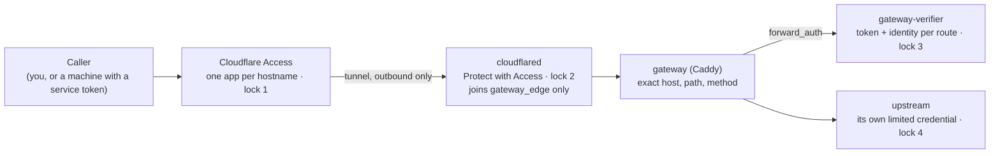

# Runbook: the secure gateway

How to set up, test, extend and switch off the one path from the internet into
the homelab. Why it is shaped this way: [`docs/design/tsd-secure-gateway.md`](design/tsd-secure-gateway.md)
and [`decisions/0002-secure-gateway.md`](../decisions/0002-secure-gateway.md).



| Piece | Where | What it does |
|---|---|---|
| cloudflared | `docker/tunnel/` | Only thing the internet reaches. Joins `gateway_edge` and nothing else. Pinned, path normalization on. |
| gateway | `docker/gateway/Caddyfile` | One site block per route. Unknown host, path or method: 404. |
| gateway-verifier | `docker/gateway/verifier/` | Checks `Cf-Access-Jwt-Assertion` (signature, issuer, expiry, the route's AUD, the hostname) and that the caller is on the route's list. Otherwise 403. |
| gateway-watch | `scripts/gateway-watch.sh`, every 5 min | Posts every refusal to `#alerts`; 24h counts for the digest. |
| access-log-poll | `scripts/access-log-poll.sh`, every 5 min | Keeps 90 days of Access logs in `/var/lib/homelab/gateway/access-log/`; alerts on new country or network, a service token used outside its source, bursts of refused logins. |
| kill switch | `scripts/gateway-off.sh` / `gateway-on.sh` | Stops or starts cloudflared only. |
| CI guard | `docker/gateway/tools/check_gateway.py` | Every route verified first, exact paths, no denylisted upstream, no hostname in the repo. |

Hostnames, AUD tags and allowlists live in `docker/gateway/.env` on CT 100 only.
This repo is public; never put them in an issue, a PR or a commit.

## One-time setup (Anthony)

Each step is in the Cloudflare or Google dashboard, or a file only you write.

1. **Accounts.** Passkey or 2FA on the Google account Access signs you in with,
   and on the Cloudflare account. A hardware key on Cloudflare if you have one.
2. **Strict service token authentication.** Zero Trust → Access controls →
   Access settings → Manage service tokens → turn on **Strict service token
   authentication**. (Organizations created after 2026-10-05 already have it.)
   It makes a bad token a plain `401`/`403`, never a login page.
3. **Read-only API token for the log poller.** My Profile → API Tokens → Create
   custom token, permissions *Account → Access: Audit Logs → Read* and
   *Account → Access: Service Tokens → Read*, nothing else, this account only.
   On CT 100:

   ```sh
   install -d -m 700 /root/.config/homelab
   install -m 600 /dev/null /root/.config/homelab/gateway-poll.env
   nano /root/.config/homelab/gateway-poll.env
   ```

   ```sh
   CLOUDFLARE_ACCOUNT_ID=<account id, from the dashboard's URL or Overview>
   CLOUDFLARE_ACCESS_LOG_TOKEN=<the token>
   # Optional: alert when this many logins are refused in one 5-minute run.
   ACCESS_DENIED_ALERT=10
   # Per route, where its service token should come from: `aws`, CIDRs, or both.
   # GW_SOURCE_ALEXA=aws
   ```

4. **Cloudflare notifications** (Notifications → Add), each to email, or to a
   Discord webhook for `#alerts` if you add one as a destination:
   - *Tunnel Health Alert* for the `homelab` tunnel;
   - *Tunnel Creation or Deletion Event*;
   - *Expiring Access Service Token Alert*;
   - *Certificate Transparency Monitoring* (SSL/TLS → Edge Certificates on the
     zone): a certificate for the zone that Cloudflare did not issue.
5. **Healthchecks.** Two checks, period 5 minutes, grace 30 minutes, ping URLs
   into `docker/monitoring/.env` as `HEALTHCHECKS_GATEWAY_WATCH_URL` and
   `HEALTHCHECKS_ACCESS_LOG_URL`.

## Bring the gateway up with the selftest route

The `selftest` route has no upstream: a verified `GET /selftest` answers with
who the verifier saw. It exists to prove the locks on the real box, then goes.

1. **Pick a hostname:** a random first-level label under the zone.

   ```sh
   echo "$(tr -dc 'a-z0-9' </dev/urandom | head -c 8).brignano.io"
   ```

2. **Service tokens.** Zero Trust → Access controls → Service credentials →
   Create two: `selftest` and `selftest-wrong`, duration 1 year. Keep both
   Client IDs and secrets for the tests below (a password manager, not a file).
3. **Access application, before any DNS exists.** Access controls →
   Applications → Add → Self-hosted, hostname from step 1. Policies:
   - *Me*: Allow, Include emails = your Google address;
   - *selftest machines*: Service Auth, Include service tokens `selftest` and
     `selftest-wrong` (the second one is on purpose: Access lets it in, the
     gateway must not).

   Session duration 24 hours. Turn on *401 Response for Service Auth policies*.
   Copy the **AUD tag** from the app's Overview.
4. **Tunnel route.** Networks → Tunnels → `homelab` → Published application
   routes → Add: the hostname, service `http://gateway:8080`. Under
   *Additional application settings → Access*: **Protect with Access** on,
   *Enforce*, AUD tag from step 3. This also creates the DNS record.
5. **`docker/gateway/.env`** on CT 100 (copy `.env.example`):

   ```sh
   ACCESS_TEAM_DOMAIN=<team>.cloudflareaccess.com
   GW_HOST_SELFTEST=<hostname from step 1>
   GW_AUD_SELFTEST=<AUD tag>
   GW_ALLOW_SELFTEST=<your Google email>,token:<selftest Client ID>
   ```

   and `docker/tunnel/.env` with `CLOUDFLARE_TUNNEL_TOKEN` (tunnel → Configure →
   the token in the install command), if it is not there already.
6. **Deploy.** `gateway` has to be up before `tunnel`: it creates the
   `gateway_edge` network cloudflared joins.

   ```sh
   hl-ssh -t "cd /root/homelab && claude '/deploy'"
   ```

   By hand, that is `docker compose -f docker/gateway/docker-compose.yml up -d --build`,
   then `docker compose -f docker/tunnel/docker-compose.yml up -d`, then
   `./scripts/install-cron.sh`.

## Self-tests

Run from a machine **off** the home network (a phone hotspot is fine). `H` is
the hostname, `ID`/`SECRET` a service token's.

| # | Command | Expect |
|---|---|---|
| 1 | `curl -si https://$H/selftest \| head -1` | `401` or `403` from Cloudflare (or a 302 to the login page in a browser) |
| 2 | `curl -si -H "CF-Access-Client-Id: $ID" -H "CF-Access-Client-Secret: $SECRET" https://$H/selftest` (selftest token) | `200`, body `gateway selftest ok: token:<id>` |
| 3 | same headers, `https://$H/admin` | `404` from the gateway, and within 5 minutes a *Gateway refused* message in `#alerts` |
| 4 | same, with the `selftest-wrong` token on `/selftest` | `403` from the verifier, and an alert naming `token:<id> is not allowed on route selftest` |
| 5 | **Fail-closed drill:** delete the Access application, repeat 2 | refused (cloudflared has no valid token to check; the gateway would refuse too). Recreate the app, put the new AUD in both the tunnel route and `.env`, `docker compose -f docker/gateway/docker-compose.yml up -d` |
| 6 | <https://crt.sh/?q=brignano.io> | no certificate names the hostname (the zone wildcard covers it) |
| 7 | `nmap -Pn -p- <home public IP>` from the hotspot | no open ports |
| 8 | `scripts/gateway-off.sh`, then test 2 | Cloudflare error 1033 within a minute; `scripts/gateway-on.sh` restores it |
| 9 | Healthchecks | both gateway checks green |

Paste the outputs (hostname and IDs redacted) into the issue that removes the
selftest route.

### Remove the selftest route

Delete its Access application, the tunnel route (and its DNS record if it
stays), both service tokens, and the three `GW_*_SELFTEST` lines. Then a PR
removes its block from the Caddyfile and its lines from
`docker/gateway/docker-compose.yml` and `.env.example`.

## Adding an endpoint: the checklist

One issue and one PR per endpoint, every line ticked. No new design work.

1. **Is public needed at all?** LAN or tailnet, or the `life` Remote Control
   session for cloud Claude, wins whenever it works. If it does, stop.
2. **Not on the denylist**: Actual Budget and its MCP, Portainer, Grafana,
   Prometheus, Proxmox, AdGuard, Jellyfin, qBittorrent and the *arr apps,
   Matterbridge, Kali, Home Assistant's UI. CI enforces it.
3. **Name the caller.** A person (your login), or a machine: one new service
   token per caller, never shared, 1-year expiry.
4. **Smallest surface.** Exact paths and methods, read-only unless writes are
   the point, a body-size limit.
5. **Least-privilege upstream credential** in `docker/gateway/.env`
   (`GW_UPSTREAM_TOKEN_<ROUTE>`), passed only to the `gateway` service. Never
   held by the caller.
6. **Hostname:** a new random first-level label, in `.env` only.
7. **Access application** for it, before the DNS route: *Me* or a Service Auth
   policy for its one token, a short session for anything that changes state,
   *401 Response for Service Auth*, AUD into `.env`.
8. **Tunnel route** → `http://gateway:8080`, Protect with Access on, AUD set.
9. **Gateway route block**: copy the commented example at the bottom of the
   Caddyfile. Add the route's lines to `docker/gateway/docker-compose.yml`
   (`GW_HOST_*` to both services, in the gateway as
   `${GW_HOST_<ROUTE>:-<route>.invalid}` so a blank value cannot take the
   gateway down, `GW_AUD_*`/`GW_ALLOW_*` to the verifier, the upstream
   credential to the gateway) and to `.env.example` (empty). If the
   upstream is another stack, join its network; if it is Home Assistant on
   host networking, add `extra_hosts: host.docker.internal:host-gateway` and
   a non-internal network for it.
10. **Run self-tests 1–5 and 8** against the new hostname; paste the output in
    the PR.
11. **Alerts:** send one request to a path not on the route, see it in
    `#alerts`. For a service token, set `GW_SOURCE_<ROUTE>` in
    `gateway-poll.env`.
12. **Write it down:** a `docs/setup-log.md` entry and an AGENTS.md "Stack
    overview" row.

Deploying a route change: `docker compose -f docker/gateway/docker-compose.yml up -d`
(new env lines recreate both containers) and `docker compose -f docker/gateway/docker-compose.yml restart gateway`
for a Caddyfile-only change, since the Caddyfile is bind-mounted.

## When something looks wrong

- **Kill switch first, questions after:** `scripts/gateway-off.sh`. Every
  endpoint is offline in seconds; nothing on the LAN or tailnet changes.
- **A stolen service token:** Zero Trust → Service credentials → the token →
  *Rotate secret* (revoke immediately), or delete it. Update its caller.
- **What happened:** `docker logs --since 1h gateway` (every request),
  `docker logs --since 1h gateway-verifier` (every token check, with the
  reason for each refusal), `/var/lib/homelab/gateway/access-log/<day>.jsonl`
  (Access sign-ins, 90 days), and Loki in Grafana (`container="gateway"`).
- **Error 1033:** cloudflared is not connected: off by the kill switch, or down.
- **Error 1050:** the hostname has no Access application. Create it (or delete
  the tunnel route); never leave a route without one.
- **Every request 403 at the gateway:** `docker logs gateway-verifier`. Most
  likely an AUD that changed when the Access app was recreated, or
  `ACCESS_TEAM_DOMAIN` unset.
